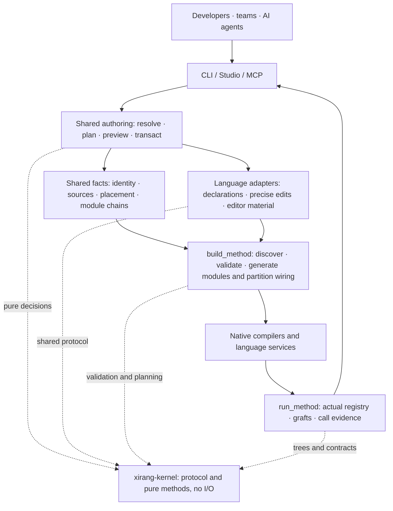
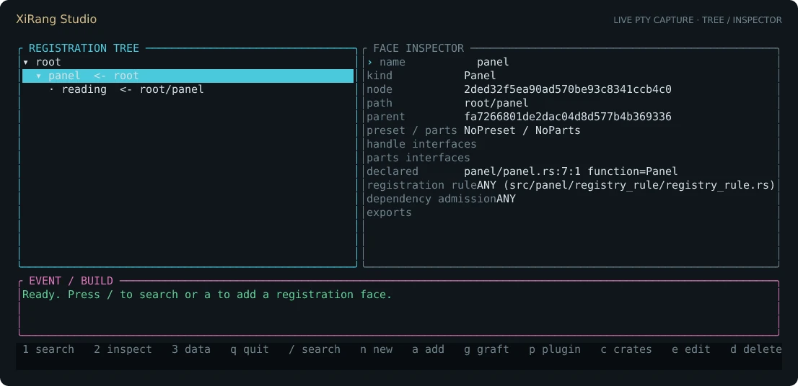

<div align="center">


# XiRang · 息壤

**An engineering framework that gives code explicit organization and collaboration boundaries, so people and AI can extend, replace, and verify it together.**

[简体中文](README.zh-CN.md) · [User guide](docs/using-xirang.md) · [Extend a language](docs/extending-languages.md) · [Discussions](https://github.com/Nichtigott/xirang/discussions)

[](.github/workflows/ci.yml)
[](LICENSE)


</div>

An `Area` can belong to a `Panel`, live in a separate source directory, and be compiled by another crate. A team can also deliver a compatible implementation and **graft** it into a slot chosen by the host. Each change has a distinct meaning; the tools maintain the connections.

XiRang provides a registration protocol, build wiring, CLI, Studio TUI, and MCP around a Rust host. It is intended for long-lived frameworks, component libraries, and projects maintained by multiple people or agents. For a small application assembled in one place, ordinary modules are often enough.

> **The name:** XiRang (息壤) is the self-growing soil of Chinese mythology. Here it describes an engineering ambition: new parts grow from an existing structure, with room for implementations from other people. `Soil` declares a registration face; `graft` selects a replacement; a `Registry` receives the objects.

The project brings together two questions: **Can an AI read engineering responsibilities before making a change, without being retold the project in every prompt? Can code organization itself leave attachment points for independent community implementations?** The first needs inspectable context and change boundaries; the second needs contracts and replacement mechanisms. XiRang puts them in one organizational model.

The practical benefits are fewer parent-maintained child lists, an explicit validation point for replacements, and common facts for people, editors, and agents. Maintaining declarations and verification has a cost; the adoption tradeoffs below make that explicit.

## Start in five minutes

Use a checkout to try the capabilities described here; published packages may lag behind this branch. You need **Rust 1.96.0 or newer**, Cargo, and a native linker. C++ examples also require a C++ toolchain.

```sh
git clone https://github.com/Nichtigott/xirang
cd xirang
cargo install --path toolchain --features cli,lang-cpp

# Point the new host at this XiRang checkout.
xirang new my-app --lib --path "$PWD"
cd my-app

# Inspect the plan first. --write applies it.
xirang face add panel --lang rust --fields '{"needs_registry":true}'
xirang face add panel --lang rust --fields '{"needs_registry":true}' --write
xirang check
cargo build
xirang explain root/panel --json
xirang studio
```

For a released version: `cargo install xirang-toolchain --features cli`. The `cli` feature installs `xirang`, `cargo-xirang`, `xirang-studio`, and `xirang-mcp`; the checkout-only `xirang-dev` is excluded. Run `xirang face languages` to inspect the authoring adapters in your binary.

This creates a registration skeleton. You still supply the implementation and behavioral tests. `check` validates registration facts; `cargo build` compiles the generated connections. Neither proves application behavior.

The [user guide](docs/using-xirang.md) covers existing projects, separate source directories, editing, MCP setup, grafts, partitions, verification, and team workflows.

## Three changes, three operations

| Intent | Mechanism | What must remain consistent or be verified |
| --- | --- | --- |
| Change an object's parent or source placement | `move` and explicit placement mappings | Object continuity, parents, references, ledger, consumers |
| Keep a slot and select another implementation | `graft` | Boundary contracts, admission, effective tree, behavior |
| Change which packages compile the implementation | `crates` partitioning | Logical catalog, dependency edges, type ownership, host wiring |

**The registration tree, filesystem tree, and compilation partitions can align without being coupled.** Default creation follows the conventional layout. An explicit `--file` establishes another placement; descendants can inherit it or override it again. Directories still organize multilingual code, while declarations and shared facts describe registration relationships.

Identity is explicit too. Today's `NodeId` retains the compatible source-instance identity rules. `StableFaceId` and the object ledger connect a persistent object to its current and historical instances. Changing the absolute checkout location should preserve identity; changing the recorded source spelling can produce a new `NodeId` and requires migration. Content digests describe versions; machine paths locate files.

Local source declarations and machine bindings exist. **Arbitrary remote islands with pinned materialization, cross-platform equivalence, and whole-project testing are outside this foundation acceptance.** The production pipeline has worker and queue commands, but those commands alone do not prove that complete workflow.

## Ordinary code, explicit boundaries

Types and algorithms remain ordinary Rust. A registration face says what an implementation is, where it belongs, and what it provides. A parent does not maintain a central roster of every child.

```rust
pub struct Button;

#[xirang_toolchain::soil]
pub const SOIL: xirang_toolchain::Soil = xirang_toolchain::Soil::of::<Button>()
    .under(crate::control::NODE_ID)
    .exports(&["control.render"])
    .needs_registry(false);
```

This fragment assumes an existing `Control` parent. See [control-button](examples/control-button) for a compilable host. An `exports` declaration describes an interface; it does not implement that interface for you.

| Vocabulary | Question it answers |
| --- | --- |
| `Soil` / registration face | How does this implementation enter the shared structure? |
| `Registry` | Where does it belong, and who owns the next level? |
| `registry_rule` | What structure, interfaces, and exports must a child provide? |
| `admission` | Which external registration paths may this branch use? |
| `FlowContract` | What contract identity, version, input, and output does replacement promise? |
| `catalog` | How can an object be referenced independently of its compilation owner? |
| `graft` | Which compatible implementation occupies this slot? |

Rust checks type constraints. XiRang adds structural, admission, and graft checks. Matching contract labels cannot prove equivalent algorithms; consumer tests and counterexamples still matter.

## A code structure with room for a community

A contributor can maintain an implementation in its own crate. The host chooses the attachment point, while the framework and third-party source remain separate. Implementations become candidates under a common contract, available for comparison and adoption.

```rust
pub const GRAFTS: &[xirang_toolchain::Graft] = &[
    xirang_toolchain::graft(crate::catalog::control::object::BUTTON)
        .with(control_button_graft::button_fast::NODE_ID),
];
```

This follows the repository's example host. The boundary is checked before overlay, and the host makes its selection explicit. A graft does not automatically reroute every Rust call or provide live code replacement; the host must connect execution to its effective tree.

Contributors can offer replacements without maintaining a full framework fork. Maintainers can keep alternatives outside the main implementation. **The community mechanism is a publishable boundary and a selectable attachment point**, supported by contracts, version policies, and verification.

Read [grafts and coordinated replacements](docs/graft.md) and [declarations and language extensions](docs/extending-languages.md).

## The project is the memory

XiRang brings engineering context into AI workflows: current responsibilities, applicable precedents, modification boundaries, and verification obligations. Conversations end; declarations, rules, adopted references, and tests remain with the project.

| A new contributor or agent asks | Project memory should answer with |
| --- | --- |
| Where does this feature belong? | Responsibilities, registration ownership, source locations, dependencies |
| How are related features written? | Applicable siblings, adopted specimens, legitimate variations |
| Which boundaries must this change preserve? | Type and flow contracts, providers, consumers, admission |
| Why these names, aliases, and comments? | The convention's source, scope, executable checks, exceptions |

Memory needs freshness. Source changes can invalidate an adoption, and similar siblings can share the same mistake. Useful precedents need applicability conditions, positive examples, fault-detecting counterexamples, and permitted variations.

### Extend a family; evolve a responsibility

For a new sibling, find a suitable reference and the parent's rules, reuse the boundary, implement the difference, and verify existing siblings. For a new internal layer, preserve the external promise, organize the responsibilities, and verify that consumers actually use the new layer.

MCP connects that process to tools: `explore` returns source and responsibility context; `consistency` compares a family; `converge` joins contracts, consumers, and evidence; `apply` previews structural changes; `check` and candidate workflows support verification.

```text
Understand → choose precedents → scope and budget → preview
           → implement → compile and test behavior → independent review → adopt learning
```

This is the recommended engineering workflow. Enforcement depends on the execution mode and project policy. Ordinary MCP cannot stop writes through an unrelated shell, and candidate landing checks are not an OS sandbox. An upstream defect calls for an evidenced scope proposal, rather than an unauthorized expansion or a downstream workaround that violates the contract.

### How conventions become durable

This project follows a practical loop: a real failure, a minimal counterexample, a fix, a regression, then an explicit convention. Mechanically checkable standards live in [conventions](conventions): kernel purity, module mounting, compatibility paths, documentation examples, and feature gates. Semantic requirements retain tests and review obligations.

The rules need tests too: reject bad implementations, accept good ones and valid exceptions. Historical evidence must not pass for current evidence. Proposed experience becomes reusable policy only through the project's acceptance process.

The [MCP user guide](docs/using-xirang.md#mcp) describes current entry points. Project memory and managed maintenance continue to evolve; establish guarantees from the execution mode, implementation, and matching acceptance evidence.

## One model, several surfaces



| Part | Responsibility |
| --- | --- |
| [`kernel/`](kernel) | Identity, declarations, trees, contracts, syntax, pure decisions; no filesystem or process binding |
| [`toolchain/`](toolchain) | Seven execution surfaces: build, run, evidence, plugins, Studio, MCP, CLI; shared authoring service |
| [`multilang/`](multilang) | Language adapters, SDKs, and the separate multilingual production pipeline |
| [`macro/`](macro) | Rust declaration front end at compile time |
| [`conventions/`](conventions) | Executable standards for this checkout; not a published runtime dependency |

Adapters own language differences. Execution surfaces own filesystem and process work. CLI, MCP, and Studio reuse services; adding a language should not recreate identity, placement, and transactions in each UI.

### Extend a language

A **registration adapter** understands declarations. A **build backend** builds and tests code. Implement the parts you need and declare their limits separately.

| Layer | What an extension provides |
| --- | --- |
| Registration and editing | `LanguageAdapter` capabilities, `plan`, `read`; `plan_move` and `editor_material` where supported |
| Build and execution | Discovery, action plans, actual builds/tests, diagnostics, evidence; optionally an external backend process |
| Cross-language calls | A representable ABI, generated bindings, ownership and error conventions, consumer tests |
| Acceptance | Real hosts, round trips, mixed parent chains, failure behavior, relocated checkouts, consumer consistency |

Rust and C++ have real mixed-registration host rehearsals. Python has an authoring adapter and SDK; **its production integration with this foundation remains paused**. The separate production pipeline already has some Python capabilities. Other languages declare support per backend and per capability; appearing in a list does not imply complete integration.

Ordinary rust-analyzer and clangd consume native declarations and generated material. Cross-language completion needs type and binding data. A path map cannot make arbitrary language types interoperable. See the [language extension guide](docs/extending-languages.md).

## CLI, Studio, and agents



*Actual terminal output from the current program in a temporary host: tree, inspector, and controls, with the legacy decorative banner cropped.*

Use the CLI for scripts, Studio for browsing and interactive authoring, and MCP for evidence-driven agent work. In Studio: `a` adds, `e` edits, `g` opens graft management, `/` searches, `r` reloads, `b` checks the build, and `q` quits.

Start MCP with:

```sh
XIRANG_PACKAGE_ROOT=/absolute/path/to/my-app xirang mcp
```

Begin with `xirang.explore {"query":"root/panel"}`. The default entry points also include `xirang.apply` and `xirang_tools`. Answers distinguish declarations, static candidates, build projections, and recorded runtime evidence. A discovered relationship is not proof of causality. See [configuration and calls](docs/using-xirang.md#mcp).

Teams share source, contracts, object ledgers, and accepted rules; absolute machine paths belong in local bindings. Use separate branches or working copies, explicit write scopes, and evidence tied to a snapshot. Parallel agents are useful for independent changes and reviews. Concurrent edits to the same files can invalidate evidence; XiRang does not replace Git merges or conflict resolution.

## Learning from other tools

| Tool or approach | Starting point | Relationship to XiRang |
| --- | --- | --- |
| Rust modules, traits, Cargo | Language types, modules, package dependencies | Retained; XiRang adds object organization, boundaries, and replacement intent |
| CodeGraph / CodeQL | Symbols, calls, code analysis | Complementary; XiRang focuses on declared responsibilities and controlled changes |
| Bazel | Build graphs, platforms, caching, execution, test rules | A source of input-closure and evidence ideas; no claim of equivalent distributed maturity or ecosystem |
| Plugins / DI / distributed registration | Discover implementations and compose applications | XiRang adds recursive registration, contracts, and grafts when the project needs them |

The goal is less repeated work understanding a project, maintaining its connections, and proving a change. Time, token, and compute savings require comparable tasks, configurations, and acceptance criteria. There is no blanket superiority claim. The exploration focuses on responsibility context, input closure, and delivery evidence; it does not establish a general performance ranking.

## Adoption tradeoffs

You maintain declarations, contracts, and verification, add host build wiring, and use tools for managed structural changes. Default directory conventions reduce configuration; explicit mappings provide flexibility. An arbitrary manual file move is not a completed migration.

A generated crate is a compilation projection, not automatically another independently editable source repository. Edit authoritative host source and regenerate. Multiple writable islands, synchronized work versions, pinned whole-project tests, and remote scheduling need their own protocols and acceptance.

Incremental indexing, end-to-end parallelism, and performance still have follow-up work. Some native-declaration packages currently bypass the row cache. The registration tree is not the complete call graph: dynamic dispatch, FFI, and runtime values require observation; unobserved does not mean absent.

## How XiRang uses XiRang

[control-button](examples/control-button) and its [external graft](examples/control-button-graft) are actual hosts exercising declarations, contracts, replacements, and runtime trees. [island-loop](tools/xirang-island-loop) and [partition-rehearsal](tools/xirang-partition-rehearsal) drive actual MCP/Cargo workflows. [External callers](tools/xirang-api-compat) exercise API compatibility.

Repository policy lives in `AGENTS.md`; executable checks live in conventions. This self-use means exercising the hosts, tools, and maintenance workflow. It does not mean every utility function is registered as an object.

```sh
# From the XiRang checkout, with the required native toolchains.
tools/xirang-island-loop
tools/xirang-partition-rehearsal
tools/xirang-api-compat
tools/xirang-test
```

See each script for offline defaults and cold-environment options. Acceptance belongs to a specific source snapshot. Historical passes do not certify a changed checkout. Old API compatibility entries remain; extensions should exercise both old callers and old trait implementers.

## Read more and contribute

[User guide](docs/using-xirang.md) · [Language extensions](docs/extending-languages.md) · [Grafts](docs/graft.md) · [Migration](docs/migration.md) · [Threat model](docs/threat-model.md) · [Roadmap](docs/ROADMAP.md)

Concrete use cases, minimal failures, language adapters, and compatible independent implementations are welcome. A feature contribution should include success and failure paths and state its verification scope. A proposed convention should also explain which legitimate differences it permits.

[MIT License](LICENSE) · [Issues](https://github.com/Nichtigott/xirang/issues) · [Discussions](https://github.com/Nichtigott/xirang/discussions)
