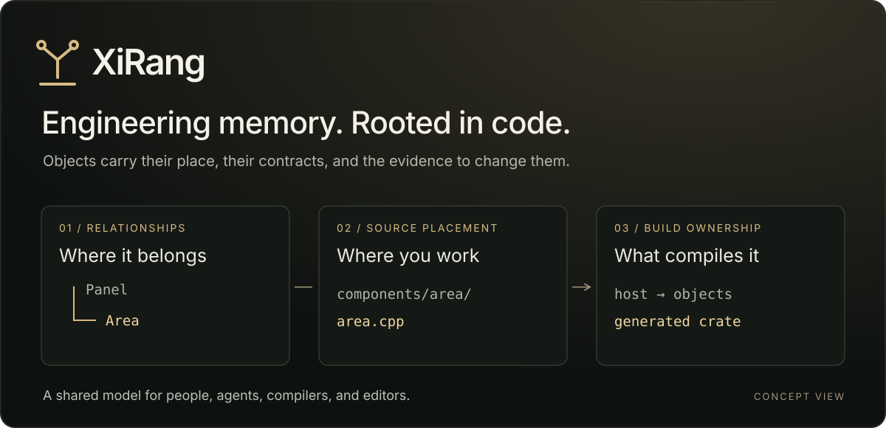
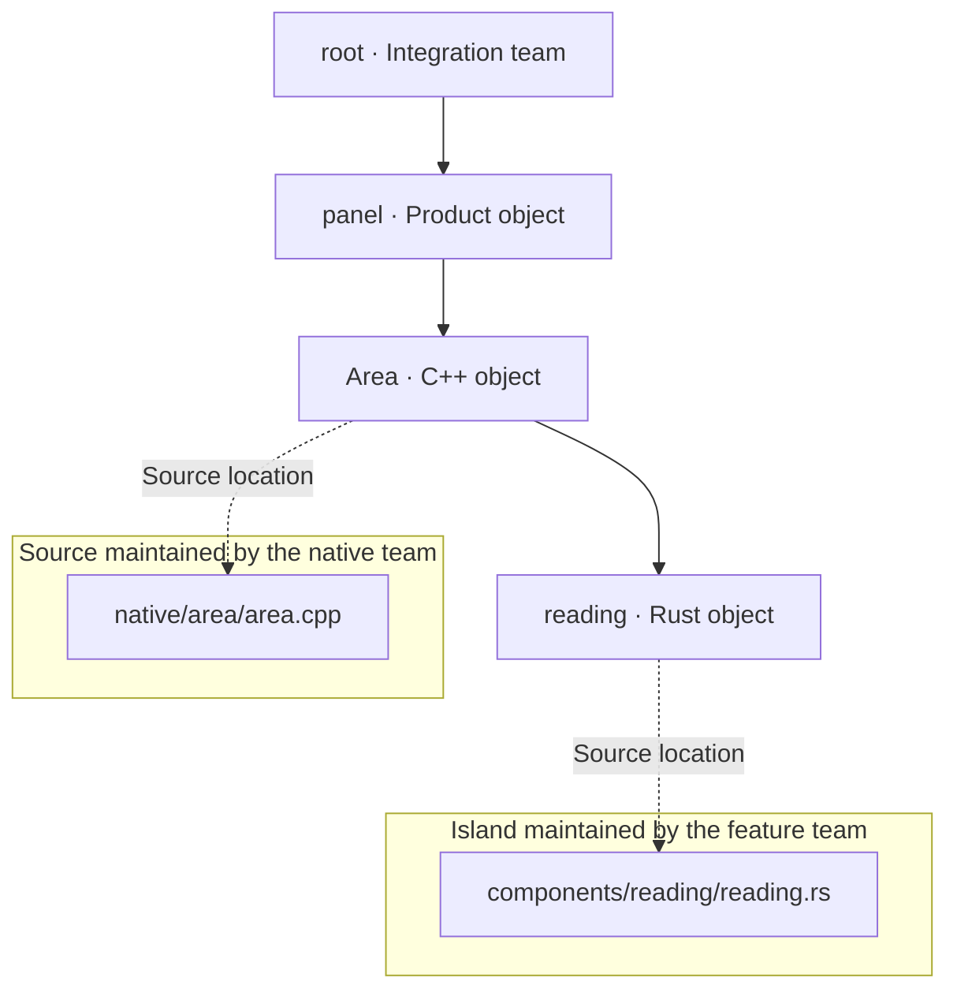
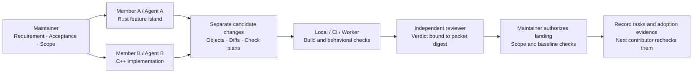
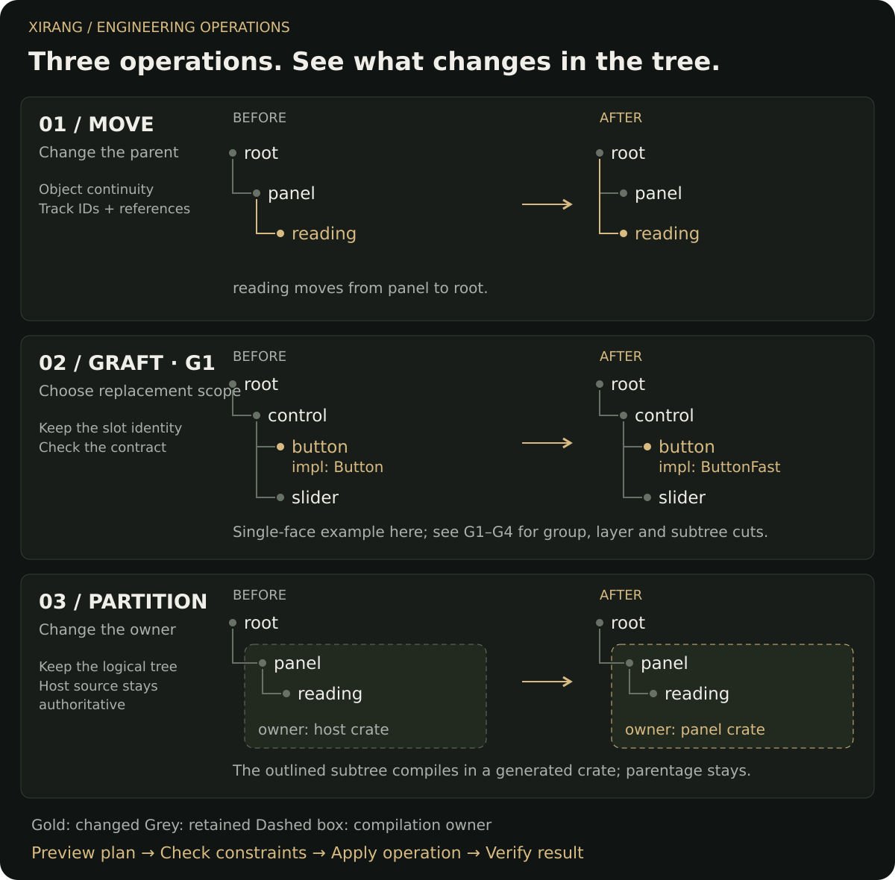
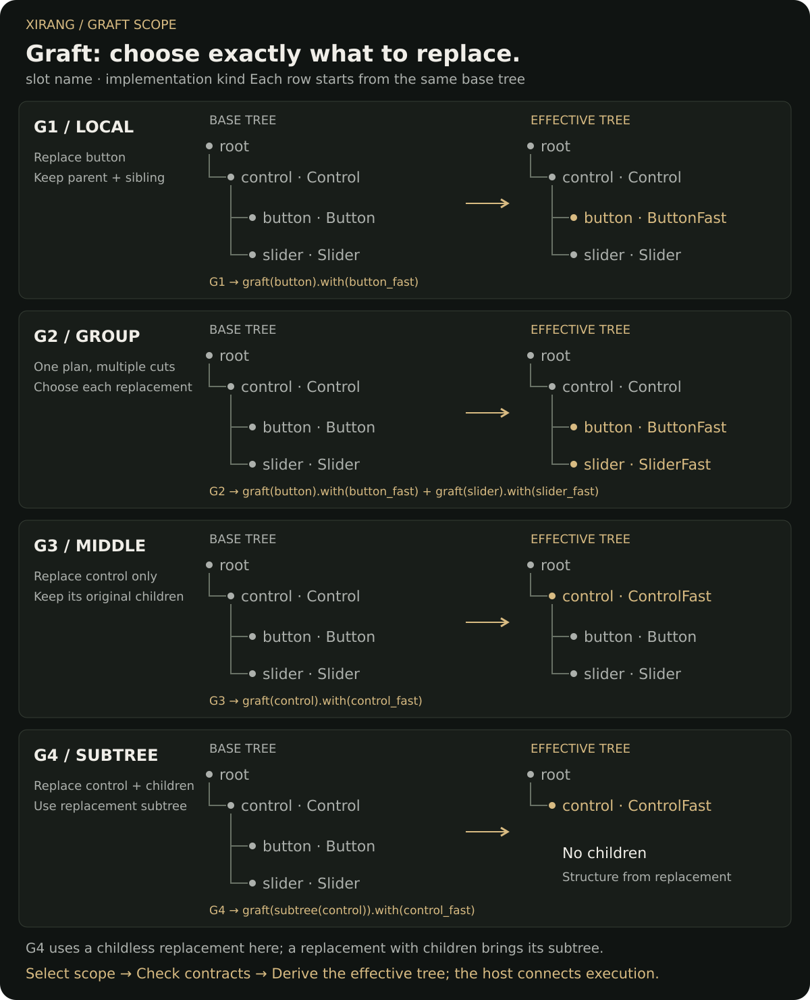
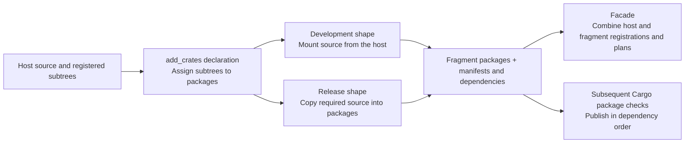
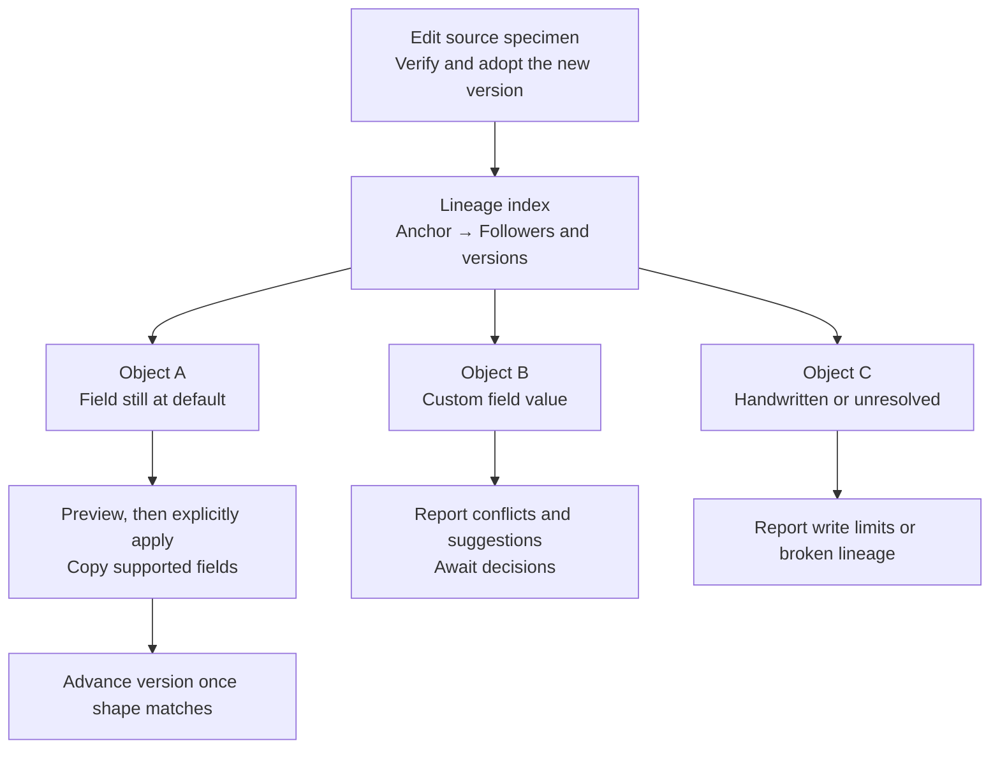
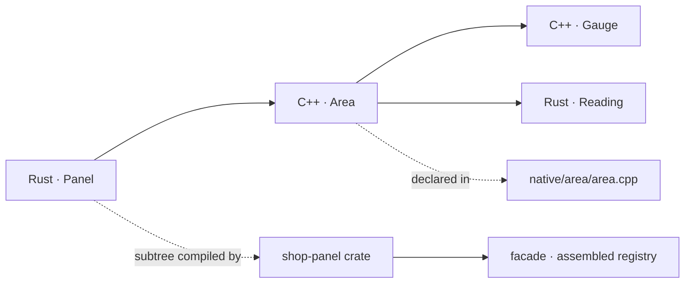
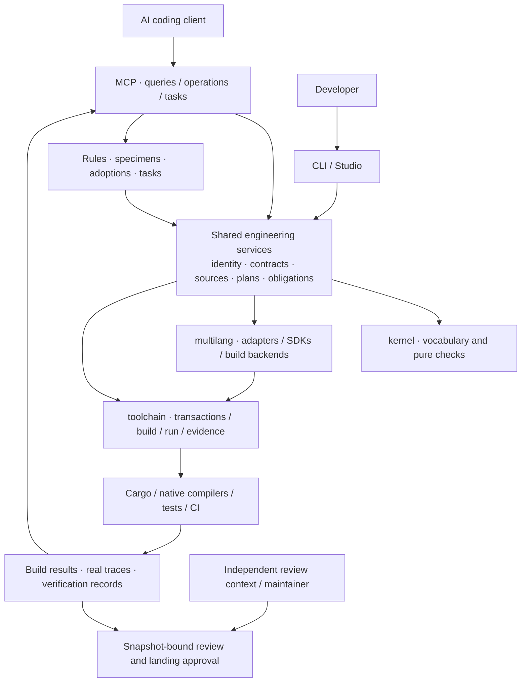

<div align="center">


# XiRang · 息壤

**An atomic project management framework built on self-organization through passive registration.**

Passive registration · Source islands · Graft composition · Deferred packaging with add_crates · Mixed languages / AI

[简体中文](README.zh-CN.md) · [User guide](docs/using-xirang.md) · [Six engineering problems](docs/ai-engineering-workflow.md) · [Extend a language](docs/extending-languages.md)

[](.github/workflows/ci.yml)
[](https://crates.io/crates/xirang-toolchain)
[](LICENSE)

</div>

XiRang is an **atomic project management framework built on self-organization through passive registration**, for mixed-language engineering by people and AI agents. Objects declare their identities, parents and contracts alongside source. Build discovery and validation assemble an engineering object tree, allowing the project to derive structural information from its own declarations.

On this structure, **source islands separate source placement from logical parentage for team ownership; graft enables flexible implementation composition, while add_crates defers compilation and delivery package organization**. Organize code around domain responsibilities and engineering relationships first, then decide crate boundaries, reducing the mental overhead of anticipating and repeatedly restructuring packages. MCP, CLI and Studio share the resulting structural facts and operations.

People decide what may change and what must hold. Agents work within that structure; compilers, tests and reviewers provide different kinds of evidence. XiRang is intended for component platforms, frameworks and projects maintained across teams. Ordinary helper functions do not each need a registration.

> **The name:** XiRang (息壤) is the self-growing soil of Chinese mythology. New functionality grows from an existing structure, independent implementations can join established contracts, and maintenance knowledge survives the next task.

**Reading path:** [Core concept](#model) → [Passive registration](#passive-registration) → [Islands and teams](#islands) → [Atomic operations](#operations) → [Graft composition](#graft-scopes) → [Deferred packaging](#crate-packaging) → [Memory and template evolution](#project-memory) → [Hands-on usage](#usage).

<a id="model"></a>
## Core concept: explicit boundaries, flexible composition, structure derived by the project

**Organize code around engineering relationships, derive structure from declarations, then choose implementation combinations and package boundaries.** XiRang represents project organization, implementation selection and delivery boundaries separately, reducing source restructuring as the latter two evolve.

| Layer | Core capability | Question answered |
| --- | --- | --- |
| **Structural foundation** | Self-organization through passive registration | What objects exist, where do they belong, and which boundaries apply? |
| **Source and team organization** | Islands and source mappings | Where do teams maintain source, and how does it join the shared tree? |
| **Implementation composition** | Graft | Which positions change, which implementations serve them, and what stays? |
| **Packaging organization** | add_crates | Which engineering units compile together and form delivery packages? |



Together these layers separate **project organization from project packaging**. Developers focus first on responsibilities and relationships, expressing package boundaries through later declarations. This reduces source relocation and wiring work; language visibility, dependencies and contracts must still hold.

<a id="passive-registration"></a>
### Passive registration: derive the project's own structure

Each object declares its parent and contracts beside its implementation. The builder collects declarations within supported discovery scopes, resolves identities and validates relationships to assemble the registry tree. **Parents do not maintain a handwritten roster of children**: new objects join through their own declarations.

“Passive” means parents do not actively collect each child. “Self-organization” means distributed declarations and relationships assemble into a structure. Authors declare business intent and required contracts; tools derive and analyze structural facts from declarations and source relationships. Existing calls need not be transcribed into a separate manual list. These facts can be recomputed as the project changes and support impact analysis, maintenance operations and project memory; unresolved calls must remain explicitly unknown.

**The registry tree expresses engineering object relationships.** An object can live in a separate source directory, use another language or compile in another crate. Logical placement, source placement and compilation ownership are recorded separately, so code organization need not start from the final crate boundaries.

| Concept | Meaning in the tree | Purpose |
| --- | --- | --- |
| Object and registration face | An engineering unit with identity, parentage and contracts | Associate source, rules, impact analysis and maintenance records with a specific object. |
| Slot and implementation | A host position and the implementation serving it | Preserve host boundaries while choosing a compatible replacement. |
| Source and compilation owner | Who maintains an implementation and which package compiles it | Keep source placement, logical parentage and package boundaries distinct. |
| Rules and evidence | Allowed changes and required verification | Carry knowledge into later tasks and check whether it remains valid. |

The workflow is **read context → agree scope → preview → apply → verify → independently review → retain knowledge**. Call graphs inform impact, registration contracts express boundaries, and MCP exposes the facts and operations to agents.

<a id="islands"></a>
### Islands and teams: independent source placement, shared engineering relationships

**An island is a source location outside the default discovery layout, connected to the registry tree through an explicit mapping.** Its source placement is independent; its identity, parentage and contracts still participate in the shared structure. One team can maintain `components/reading/` and another `native/area/`. They need not move into a common directory to become parent and child in the logical tree, or split into crates first.

This example shows a possible division of work: solid edges express logical parentage; dotted edges identify source locations. Team labels describe working agreements, not automatically enforced access permissions.



**Organize collaboration around objects:** implementation teams maintain source and contracts; integration teams select compatible implementations with graft and choose compilation and delivery boundaries with add_crates. Independent implementations can live in external packages, while islands let host source layout differ from logical parentage. Team directories, object trees and delivery packages can evolve separately.

Share source declarations in `xirang.sources.tsv`; keep machine-specific source roots in `.xirang/source-bindings.tsv`. The same source identifier can bind to different checkout locations on different machines, subject to source resolution and package placement rules. Missing or escaping sources are refused. Reading external source does not authorize editing it. [Usage step 3](#use-move) creates and moves an island; the [source mapping guide](docs/using-xirang.md) explains shared declarations and local bindings.

#### Working together: hand off objects, candidate changes and evidence

Developers and agents can maintain different parts of one project. Each reads the rules, specimens and impact context for their objects, then works in a candidate copy. Reviewers receive the original requirement, actual changes and verification evidence. Maintainers decide what lands; the next contributor resumes from durable tasks rather than a previous chat.



| Contributor | Entry | Handoff |
| --- | --- | --- |
| Implementer or author agent | CLI / Studio authoring; MCP queries and candidates | Responsible objects, candidate changes, verification results |
| Independent reviewer | Host-provided review packet | Verdict bound to the current packet digest |
| Maintainer or integrator | Host approval entry, graft, add_crates | Accepted changes, implementation choices and delivery boundaries |
| Next contributor | `task status/resume`, rules and adoption queries | Current evidence, stale decisions and outstanding checks |

The team or host orchestrates these roles. Candidate landing checks supported changes and baseline freshness; it does not replace Git merging or provide live collaborative editing. Independent review needs separate context and permissions. The [team walkthrough](docs/ai-engineering-workflow.md) supplies candidate, verification, review and landing requests.

#### Remote collaboration: delegate builds and verification to workers

`xirang remote` delegates multilingual production builds and tests to workers, queries evidence and retrieves artifacts. The CLI provides command transport and an `--ssh` preset, with timeout, retry and concurrent multi-project options. MCP's production queries expose plans and reports to agents; CLI or CI performs execution.

**Prepare source separately from dispatching jobs.** Remote jobs carry an absolute project path and do not upload source automatically. An SSH worker needs XiRang, the required toolchains, and matching project source and dependencies at that same absolute path, or a custom transport must adapt paths. Islands do not synchronize repositories. See [remote usage](docs/using-xirang.md#remote-workers) for a local protocol trial and SSH examples.

<a id="operations"></a>
## Atomic operations: create, move, graft, partition and adopt

On the object tree formed by passive registration, creation, move, graft and partition address growth, logical placement, implementation selection and compilation ownership. Start with their effects in the figure, then explore graft and add_crates in detail. Each operation expresses a specific intent; composition must still satisfy their individual preconditions.



**Atomic operations** means explicit units of maintenance intent that can be previewed and composed. Supported multi-file write paths use transactions and recovery. It does not mean every sequence is one database transaction or that all operations are crash-safe across power loss.

| Intent | Entry | Meaning |
| --- | --- | --- |
| Create or change an object | `face add/edit`; MCP `apply: add/edit/rename` | Resolve parent, language and destination before editing; change only named fields. |
| Add internal structure | MCP `apply: deepen` | Extend a face's parts while retaining its public registration position. |
| Move an object or subtree | MCP `apply: move` | Carry supported references, ledger facts and migration records; distinguish persistent objects from source instances. |
| Replace a face, group, layer or subtree | graft plans (G1–G4) | Select scope and replacements, check contracts, derive an effective tree; see G1–G4. |
| Adopt a confirmed replacement into the base | MCP `apply: promote` | Update the target declaration and retire the cut/record, subject to confirmation and source/rewrite constraints. |
| Change compilation ownership | `xirang crates` | Assign subtrees to generated crates and wire dependencies/facade; the host remains the authoritative source. |
| Remove a tool-generated face | MCP `apply: delete` | Move it into recoverable trash; rewriting handwritten faces requires separate adoption. |

Registration relationships, source locations and compilation ownership are separate dimensions. `StableFaceId` tracks object continuity; `NodeId` identifies a source instance. Moving or renaming can produce a new instance, with the mapping recorded. “Same object” does not mean “every ID stays unchanged.”

<a id="graft-scopes"></a>
### Graft: make code open to community composition

**Graft is one of XiRang’s core project management capabilities, built on self-organization through passive registration.** Adopt another team’s local implementation, replace an intermediate layer while retaining existing children, or use one compatible implementation across a group of slots. Slots can also receive different implementations. Implementations supply replacement content; a graft plan declares targets and scope. Contract checks determine whether the composition is valid.

**The design goal is to give code a structure that invites community participation.** Developers can maintain implementations of individual objects or layers; others can adopt, try, compare and combine compatible alternatives. Contributions can join upstream or remain independently maintained, while hosts participate by choosing implementations. Local optimizations, experiments and different styles can coexist, making projects more open to exploration and creative recombination.

A graft can target a leaf, several slots, an intermediate layer or a whole subtree. It assigns **selected positions in the base tree** to external implementations and derives an effective tree after validation. Both input trees remain unchanged. Each row below is an independent alternative, not one step in a sequence.



| Figure | Selection | Treatment of children |
| --- | --- | --- |
| **G1 Local** | One face, such as button | Keep the parent and siblings; a selected face's original children are inherited by default. |
| **G2 Group** | Several cuts in one plan, each with its own replacement; `range(a, b)` also selects contiguous siblings | Ordinary cuts retain their children. A range uses one replacement for each selected slot, rather than merging the slots. |
| **G3 Intermediate layer** | A parent face, such as control, using ordinary `graft(control)` | Keep original children. Reject a replacement that cannot host them or whose rules/contracts they violate. |
| **G4 Whole subtree** | `graft(subtree(control))` | Original descendants leave the effective tree; the replacement brings its own subtree. A childless replacement produces a leaf. |

An intermediate layer is a cut position, not a different API. **Ordinary graft replaces selected faces; `subtree` explicitly changes descendant inheritance.** A multi-cut plan returns an effective tree only after validation. Group replacement is not a global method-name substitution.

#### Replacement boundaries include existing dependencies and behavioral evidence

How external code already uses an object also constrains replacement. Declarations may be incomplete, so boundary analysis needs registration contracts, source call relationships and runtime evidence. Current tools expose impact queries. Graft resolves the selected scope and checks declared input/output contracts, destination rules, admission and connectors; retained children must also satisfy the replacement's rules.

**The direction for automatic boundary protection** is to identify consumers outside the cut, determine interfaces that must remain, capture reproducible behavior baselines, and turn them into rules and verification obligations. Required compatibility tests would then gate acceptance. Original return values are samples for particular inputs and environments; intended invariants and allowed behavior changes must be distinguished.

**Current implementation:** this checkout does not yet connect automatic discovery of all external calls, preservation of corresponding functions and original return values, rule generation and mandatory behavioral tests into a general graft workflow. `overlay` contract validation does not run application tests. MCP `check` executes a selected verification plan, and its coverage depends on the checks actually run. Wire consumer compatibility tests into verification; structural acceptance alone does not prove behavioral preservation.

**Why not just a Git branch?** Git tracks source versions. Graft expresses composable implementation choices within one version. Teams can maintain compatible implementations and compare base and effective trees under the host contract without copying the project for every combination.

**How does it affect execution?** The host consumes the effective tree or binding records at an actual execution entry. Graft does not intercept ordinary `Button::paint()` calls. The example verifies real calls and traces through a controlled entry; general automatic dispatch is not implemented. [Usage step 4](#use-graft) provides matching G1–G4 plans and execution steps.

<a id="crate-packaging"></a>
### add_crates: defer packaging organization

**Crate packaging still lacks flexibility for composing and delivering arbitrary object or subtree selections.** Cargo provides workspaces, dependencies and features, but moving package boundaries generally requires manual changes to manifests, module paths, visibility and cross-package references. The source layout convenient for development may also differ from the desired delivery layout.

XiRang’s **`add_crates` partitioning mechanism aims to separate project organization from packaging, making package boundaries a later decision**. Declare which crate compiles which subtrees, then generate the package structure and dependency connections. One generated crate can claim multiple non-overlapping subtrees; logical parentage and authoritative source need not be reorganized for every package split. The CLI entry is `xirang crates`, with declarations stored in `add_crates.rs`.



| Stage | What add_crates does | Result |
| --- | --- | --- |
| **Declare and plan** | Read subtree selections, build facts and host graft plans; validate the partition and calculate destinations and dependencies | A previewable compilation and package plan, not a published package. |
| **Development shape** | Generate fragment crates mounting host sources; connect workspace members, host dependencies and required re-exports | Maintain one authoritative source tree while compiling across the planned crate boundaries. |
| **Release shape** | Copy required fragment sources inside packages; generate local-source build entries and carry identity namespaces and graft cuts | Fragment source no longer relies on development-time mounts outside the package. The facade combines the host and fragments rather than copying their implementations. |
| **Package and publish** | Show inter-package dependencies and publication blockers; follow with Cargo checks for contents, dependency versions and builds | Publish only after the relevant checks. `--release` generates a release shape; it does not execute `cargo publish`. |

**Alongside graft:** graft selects implementations for engineering positions; add_crates organizes units into compilation and delivery packages. Partitioning carries host identity and graft plans so implementation choices survive a change in compilation ownership.

The mechanism currently handles **explicit subtree partitions and supported reference connections**. It does not automatically split arbitrary function sets, eliminate dependency cycles or finish every publishing configuration. Generated directories remain artifacts: edit host source, and remember that release regeneration copies it again. The project is actively maintained; add_crates aims to make source organization, implementation composition and packaging boundaries more independent while retaining checkable dependencies and identity. [Usage step 5](#use-partition) shows the development-to-release workflow.

<a id="project-memory"></a>
## Project memory: retain evidence in layers and reuse structural decisions

**Project memory records how the project is organized and which objects followed which structural version.** Engineering facts, accepted rules, template lineage and task evidence are linked by objects and scope. Their evidence is rechecked as the project changes.

| Layer | Storage | Use in the next task |
| --- | --- | --- |
| **Structure and interfaces** | Source declarations, contracts, catalog and object ledger | Resolve ownership, interface constraints, sources and previous locations. |
| **Policy and adoption evidence** | `.xirang/rules/`, `.xirang/adopted/entries` | Read applicable rules, revisions, provenance and file fingerprints; reconfirm lapsed adoption. |
| **Specimens and lineage** | Adopted source specimens, `.xirang/templates/lineage.tsv` | Track object → specimen anchor → followed version and locate followers needing migration. |
| **Work and verification** | `.xirang/tasks/`, durable check plans and journals, candidate review packets | Resume work and recheck verification, rule and knowledge obligations. |

### Template evolution: one change, indexed migrations across followers

New objects select an applicable specimen by parent and kind and record its version. After an adopted specimen changes, `refactor` enumerates followers, compares their structure and plans migration. **This reduces repeated searches for related files, repetitive field edits and manual migration tracking.**



Mechanical migration currently covers **`preset` and `parts` fields still at their defaults**, using the existing `edit` path for each object. Custom values, values removed from a template, handwritten files and missing test entries produce differences or suggestions. The lineage stores versions, not historical template bytes, so a non-default value copied from an earlier template cannot be distinguished from an intentional customization; both require a decision. Business logic is not overwritten, and templates do not relocate or rename followers. **Saving a template does not rewrite the project automatically**: adoption must be in force and migration explicitly requested. Objects advance individually; this is not one project-wide transaction.

From a host with recorded template lineage, preview the plan:

```sh
xirang-mcp --call refactor --json '{}'
```

After checking scope and reconfirming the changed specimen, restrict application to its anchor. Replace the placeholder with the actual anchor returned by the plan:

```sh
xirang-mcp --call refactor --json '{"anchor":"REPLACE_WITH_TEMPLATE_ANCHOR","apply":true}'
```

Run the relevant builds and behavioral tests afterward and inspect remaining conflicts. Shared specimens support coordinated structural evolution across the project; arbitrary code refactoring and project-wide speed claims still need a concrete migration and measurement. See [memory mechanisms](docs/ai-engineering-workflow.md) and [rules and tasks](docs/using-xirang.md#knowledge).


## Six problems in AI-assisted engineering

| Problem | What XiRang provides | What that establishes |
| --- | --- | --- |
| **Project knowledge is difficult to preserve and reuse** | Object identities, rules, adopted specimens, template lineage and resumable tasks | Decisions retain their basis, version and subject. Changed evidence can lapse an adoption; an AI suggestion does not automatically become policy. |
| **Local changes lack system-wide impact constraints** | `affected`, `impact` and `converge` combine source relationships, registration structure, contracts and verification plans | Providers, consumers and tests can be investigated together. Unresolved calls and consumers outside the query scope remain obligations. |
| **Critical architectural constraints are difficult to identify** | Parent rules, admission, capability dependencies, typed contracts and release scope | Essential boundaries become explicit constraints. Unstated business invariants still need to be supplied. |
| **Change scope lacks effective control** | Previews, candidate copies, scope/protected paths, widening approval and transactional landing | Landing checks scope and baseline freshness. Plain MCP does not block shell writes elsewhere; process write restrictions require explicit managed execution. |
| **Build results are disconnected from functional acceptance** | Separate build/test/observation evidence, durable verification obligations and task closure checks | Compilation does not substitute for behavioral tests. Passing tests establish only what was exercised. |
| **Development and review lack independence** | A review packet containing the original request, acceptance criteria, actual changes and evidence; verdicts bound to its digest | Independent review can block landing. The MCP tool cannot record its own review pass; the host or team must supply a genuinely independent review context. |

These mechanisms are implemented, but their combination is not a proof against every engineering error. See [the six-problem workflow](docs/ai-engineering-workflow.md) for entry points, rejection cases and limits.

## Mixed languages, shared engineering facts

Rust and C++ refer to the same registered object through the same logical catalog:

```text
crate::catalog::shop::panel::Area::NODE_ID
```

Rust's `crate` is a keyword; C++'s `crate` is a namespace supplied by the generated header. Paths come from **parent identity and registration name**, not a language's source directories. The real [mixed-shop](examples/mixed-shop) example connects:



A face remains where its author put it; partition planning determines which crate compiles it. `tools/xirang-mixed-shop` checks the mixed tree, partition and actual call results, including a negative control that deliberately breaks the C++ implementation.

Read language support by capability:

| Layer | Current entry and scope |
| --- | --- |
| **Declaration authoring** | Rust; optional C++, Python, C, Zig, JS, TS, Go, Java and C# adapters. `xirang face languages` reports the fields actually enabled in your binary. |
| **Host registration** | Generated Rust trees, native object records and `[record]` file producers. SDKs and hosts live in [examples](examples); combinations have separate gates. |
| **Production builds and delivery** | Backends and action plans for `xirang.toml`; inspect `xirang languages`. A build backend and a registration adapter are separate capabilities. |
| **Call semantics** | Rust `syn`, C++ clang and Python AST feed shared facts. Authoring support for another language does not imply a callgraph backend. The project is actively maintained, with additional language backends planned for future development. |

## Where MCP fits



MCP exposes engineering services to agents; compilers, behavioral tests and human decisions retain their roles. CLI, Studio and MCP share relevant facts and services but expose different capabilities. For example, MCP's production surface reads inventories, plans and reports; it does not run those builds.

## Why XiRang alongside CodeGraph?

CodeGraph already uses syntax trees, symbol resolution and call relationships. XiRang's distinction is **connecting declared engineering intent to executable maintenance operations**, beyond understanding source.

| Need | Additional XiRang facts and operations |
| --- | --- |
| Find a method and its callers | Source relationships can be accompanied by registration ownership, contracts, graft declarations and available runtime evidence. |
| Decide whether a change is allowed | Explicit parent rules, capability requirements, admission and applicable maintenance rules supplement inferred relationships. |
| Replace, move or split | Graft, move and crates express separate intents, with corresponding identity, reference and build bookkeeping. |
| Pass knowledge to the next agent | Rules, adoptions, template lineage and tasks retain evidence in layers; indexed followers receive migration plans and subsequent tasks recheck the evidence. |
| Control delivery | Candidate scope, protected content, verification plans, review packets and landing approvals form an inspectable workflow. |

**The evidence does not establish an overall win.** In the [2026-11-01 comparison](docs/codegraph-comparison.md), the 15-query evidence-item score was 43/43 versus 37/43, with longer XiRang replies. Both arms succeeded in the six-session pilot; XiRang's aggregate cost-equivalent was **1.19×** CodeGraph's. The comparison used CodeGraph 1.6.1; versions and apparatus differ between experiments. The new formal 18-session run did not successfully execute. Evidence-item coverage is neither callgraph accuracy nor model repair success.

Choose XiRang when you need **registration contracts, structural operations, mixed builds and maintenance evidence to work together**. Source-indexing tools remain valuable for exploring an arbitrary existing repository.

## What adoption asks of you

Choose meaningful registration boundaries, declare parents and contracts, wire the host build, and supply behavioral tests. Business functions remain ordinary language code. Tool-managed declarations, handwritten source and generated crates have different write policies; generated crates are not an independent source of truth.

XiRang applies the same discipline to itself: pure rules in [kernel](kernel), execution in [toolchain](toolchain), language implementations in [multilang](multilang). Concrete failures become regression tests; mechanically checkable conventions live in [conventions](conventions). Decisions and historical evaluations remain in [docs](docs). Standards become durable through explicit decisions and negative tests, not repeated model self-approval.

<a id="usage"></a>
## Usage: follow the figures through real operations

Creation and move form one sequence. Graft, partition and mixed-language sections are separate exercises. Each names its working context and expected result; do not mix paths from different hosts.

### 1. Install and create your first tree

This page describes the **current checkout**; published packages may lag behind it. Requires Rust 1.96.0+. C++ paths also require a local C++ toolchain.

```sh
git clone https://github.com/Nichtigott/xirang
cd xirang
XIRANG_CHECKOUT="$PWD"
cargo install --path toolchain --features cli,lang-cpp

xirang new my-app --lib --path "$XIRANG_CHECKOUT"
cd my-app

# Preview, then create a Panel that can own children.
xirang face add panel --lang rust --fields '{"needs_registry":true}'
xirang face add panel --lang rust --fields '{"needs_registry":true}' --write
xirang face show src/panel/panel.rs
xirang check
cargo build
xirang explain root/panel --json
```

`--path` names the XiRang checkout, not the new project's destination. Rust-only users can install with `--features cli`. That feature enables four binaries: `xirang`, `cargo-xirang`, `xirang-mcp` and `xirang-studio`. Enabling a language feature does not install its compiler.

**Existing Rust project:** add `xirang-toolchain` from the same source to regular and build dependencies. Call `build_method::run()` in `build.rs` and `run_method::host!()` in the crate root that owns the tree. Preserve existing build work and avoid duplicate module mounts. [Full integration instructions](docs/using-xirang.md#2-接入已有-rust-项目--add-an-existing-rust-project).

### 2. Read a registration declaration

A face is a declaration beside ordinary implementation code. The following illustrates a Button child; read it as a declaration example, rather than pasting it into the generated Panel file:

```rust
#[xirang_toolchain::soil]
pub const SOIL: xirang_toolchain::Soil = xirang_toolchain::Soil::of::<Button>()
    .under(crate::catalog::panel::NODE_ID)
    .exports(&["panel.render"]);

pub struct Button;
```

This declares parent and export metadata; it does not implement rendering. Add typed contracts and behavior where the host requires them. The builder records the face without a parent-maintained list of children. [Vocabulary: Soil, Registry, catalog, graft, fragment](docs/using-xirang.md#vocabulary).

<a id="use-move"></a>
### 3. Create a child, then move it to root (operation 01)

Follow [operation 01](#operations) in the my-app host from step 1. Create `root/panel/reading`, then move reading to root. Its source is outside src/, while its logical parent is explicit.

```sh
# Preview creation, then apply.
xirang-mcp --call apply --json '{"action":"add","language":"rust","parent":"root/panel","file":"components/reading/reading.rs","fields":{"module":"reading","kind":"Reading"}}'
xirang-mcp --call apply --json '{"action":"add","language":"rust","parent":"root/panel","file":"components/reading/reading.rs","fields":{"module":"reading","kind":"Reading"},"apply":true}'
cargo build
xirang explain root/panel/reading --json

# Preview the move, then apply.
xirang-mcp --call apply --json '{"action":"move","node":"root/panel/reading","to":"root","rebind_grafts":true}'
xirang-mcp --call apply --json '{"action":"move","node":"root/panel/reading","to":"root","rebind_grafts":true,"apply":true}'
cargo build
xirang explain root/reading --json
xirang-mcp --call registry --json '{"full":true,"freshness":"verify"}'
```

**Check the result:** reading now belongs to root and panel remains. Inspect the reported source destination and identity mapping, then run behavioral tests. Carry a returned `plan_id` into execution; re-preview if the baseline changes. CLI `xirang move` moves production unit directories, not registered objects. [Editing, renaming and recovery](docs/using-xirang.md).

<a id="use-graft"></a>
### 4. Apply a graft plan (G1–G4)

Follow [G1–G4](#graft-scopes) using the real example host, whose external implementations already exist. From the checkout:

```sh
cd "$XIRANG_CHECKOUT"
cargo test -p xirang-example-control-button --test registry
cargo test -p xirang-example-control-button --test graft_behavior
xirang explain --overlay --path examples/control-button --json
```

The [host entry](examples/control-button/src/lib.rs) links [control-button-graft](examples/control-button-graft). These plans correspond to the four rows:

```rust
use control_button as host;
use control_button_graft as replacement;
use xirang_toolchain::run_method::{graft, range, subtree, Graft};

// G1: replace button only.
let local: &[Graft] = &[
    graft(host::catalog::control::button::NODE_ID)
        .with(replacement::button_fast::NODE_ID),
];
// G2: replace two slots independently in one plan.
let group: &[Graft] = &[
    graft(host::catalog::control::button::NODE_ID)
        .with(replacement::button_fast::NODE_ID),
    graft(host::catalog::control::slider::NODE_ID)
        .with(replacement::slider_fast::NODE_ID),
];
// G3: replace the middle layer, retaining button and slider.
let middle: &[Graft] = &[
    graft(host::catalog::control::NODE_ID)
        .with(replacement::control_fast::NODE_ID),
];
// G4: replace descendants too; control_fast has no children here.
let whole: &[Graft] = &[
    graft(subtree(host::catalog::control::NODE_ID))
        .with(replacement::control_fast::NODE_ID),
];

// Another group selection: one replacement for each slot in a sibling range.
let siblings: &[Graft] = &[
    graft(range(
        host::catalog::control::button::NODE_ID,
        host::catalog::control::slider::NODE_ID,
    )).with(replacement::slider_fast::NODE_ID),
];

// Apply one alternative; do not combine overlapping plans.
let base = host::base_registry();
let external = replacement::external_registry();
let effective = base.overlay_static(middle, &external)
    .expect("the replacement satisfies the host contract");
```

This is a **consumer function-body snippet** for a program or integration test depending on the two example crates. Compare effective with base: G1 changes only button; G2 changes both child faces; G3 changes control to ControlFast and retains its original children; G4 removes the original children from the effective tree. Substitute local/group/whole/siblings as the first overlay argument to compare alternatives.

**In your own host:** put one selected plan in the entry calling `host!()` as `pub const GRAFTS: &[Graft]`. Use that host's `crate::catalog::…` targets, link the replacement dependency, and supply an external Registry with the same framework. Apply the build-captured plan with `base.overlay_static(builtin_static_plan().grafts(), &external)`. Declaring a plan does not call replacement methods. A pruned build must retain the selected slots; do not rely on undeclared runtime targets.

Sibling ranges are inclusive, ordered by `registry_name`, and require a shared parent. Reversed and cross-parent ranges are rejected. See the [graft reference](docs/graft.md). `tools/xirang-graft-binding` verifies a controlled execution entry's binding and real trace; it does not replace application tests for every plan.

<a id="use-partition"></a>
### 5. Assign a subtree to a generated crate (operation 03)

Follow [operation 03](#operations) in a separate temporary host to retain panel/reading as shown in the figure. Keep `XIRANG_CHECKOUT` from step 1; the host remains the authoritative source.

```sh
cd "$(mktemp -d)"
xirang new partition-demo --lib --path "$XIRANG_CHECKOUT"
cd partition-demo
xirang face add panel --lang rust --fields '{"needs_registry":true}' --write
xirang-mcp --call apply --json '{"action":"add","language":"rust","parent":"root/panel","fields":{"module":"reading","kind":"Reading"},"apply":true}'
xirang check
# Preview and write the subtree declaration.
xirang crates --declare panel --subtree crate::panel::SUBTREE
xirang crates --declare panel --subtree crate::panel::SUBTREE --write
# Preview packages and dependencies, then write them.
xirang crates
xirang crates --write
cargo build --workspace
cargo test --workspace
```

**Check the result:** panel/reading retains its logical parentage. A standalone host gets generated packages under `<host>/crates/` with workspace members and dependency connections. The figure's “panel crate” corresponds to the panel partition plan; the preview gives full generated package names. Edit host source and regenerate rather than independently maintaining generated packages. [Release partitions and recovery](docs/using-xirang.md#5-嫁接与分区--grafts-and-partitions).

#### Turn a development partition into release packages

Continue in the partition-demo host root. Both shapes use the same generated directories, so revert the development shape first. This does not delete host source or remove the partition declaration.

```sh
xirang crates --revert
xirang check
xirang crates --release
xirang crates --write --release
cargo build --workspace
cargo test --workspace
xirang crates --release
xirang-mcp --call crates --json '{"action":"plan"}'
```

Inspect package dependencies and publication blockers, and confirm that fragment packages contain their own sources. Before publishing, prepare resolvable versions and publishing metadata for the host, fragments, facade and their dependencies, then perform Cargo packaging verification in dependency order. `cargo package --list --manifest-path <generated-package>/Cargo.toml` only lists files; it does not verify the build. Successful generation or a local workspace build does not establish independent installation from a registry.

Here `--release` selects the **generated package source layout**, unlike the optimization profile selected by `cargo build --release`. It also differs from the multilingual production pipeline's `xirang package`, which packages already-built delivery artifacts. See the [add_crates mechanism diagram](#crate-packaging).

### 6. Verify mixed languages and try a standalone production build

```sh
cd "$XIRANG_CHECKOUT"
cargo test --manifest-path examples/mixed-shop/Cargo.toml
cargo run --manifest-path examples/mixed-shop/Cargo.toml -p verify --bin tree
```

Check C++ Area/Gauge and Rust Reading in the tree above. The complete `tools/xirang-mixed-shop` partition gate temporarily rewrites the example; run it in a dedicated checkout.

Try a standalone C++ production project:

```sh
cd "$(mktemp -d)"
xirang new math-kit --lang cpp --lib
cd math-kit
xirang plan --json
xirang build
xirang test
xirang report
```

The [production guide](docs/using-xirang.md#production) covers dependencies, locking, packaging, installation and rollback. Cross-language calls are limited to the supported ABI/type combinations; a shared registry does not erase language ownership, type or threading rules.

### 7. Connect agents and the team to the same engineering services

**For agents: an MCP connection.** Configure `xirang-mcp` in an AI client supporting MCP over stdio. The client launches the server and exchanges protocol messages through standard input/output. This is AI-client configuration, not Studio configuration; substitute paths and use your client's wrapper format:

```json
{
  "mcpServers": {
    "xirang": {
      "command": "/absolute/path/to/xirang-mcp",
      "env": {"XIRANG_PACKAGE_ROOT": "/absolute/path/to/my-app"}
    }
  }
}
```

Start with `xirang.explore` for current source and responsibility context, `xirang.apply` for structural changes, and `xirang_tools` to discover additional capabilities:

```json
{"tool":"candidate"}
```

Supplying only `tool` reads its schema; add `arguments` to invoke it. The maintenance path is **context and rules → bounded scope → preview → candidate work → behavioral verification → independent review → approved landing → knowledge and task closure**. See [MCP examples](docs/using-xirang.md#mcp) and [the engineering workflow](docs/ai-engineering-workflow.md).

**For people: the Studio terminal interface.** Studio is XiRang’s TUI, a separate entry from the MCP server. `xirang studio` exposes face authoring (`a/e/d`), graft records (`g`), search (`/`) and build checks (`b`); follow the current page's help. [Actual TUI capture](picture/xirang-studio-current.webp) · [capture provenance](picture/README.md).

### 8. Extend a language

```sh
cd "$XIRANG_CHECKOUT"
# In a XiRang checkout: preview only.
xirang lang new mylang --extension ml --checkout .
# Write scaffolding and feature/registry wiring; implementation is still required.
xirang lang new mylang --extension ml --checkout . --apply --register
```

Extensions live under `multilang/src/languages/<language>/`, SDKs under `multilang/sdk/<language>/`. Reuse the language kit's grammar, planning and record components; implement `LanguageAdapter`, then add a record producer, semantic provider or production backend where needed. A language within the existing protocol does not need language-specific branches in the pure kernel.

A scaffold is not a working language. Prove source round trips, real builds, runtime registration and refusal cases. A missing toolchain means unverified, not supported. See [the extension guide](docs/extending-languages.md).

## Verify and contribute

```sh
cargo fmt --all -- --check
cargo test -p xirang-conventions --offline
cargo test --workspace --offline
cargo clippy --workspace --all-targets --offline -- -D warnings
cargo clippy --workspace --all-targets --offline --all-features -- -D warnings
tools/xirang-publish --check-table
tools/xirang-test
```

`--offline` assumes cached dependencies; a cold environment needs to fetch them first. `xirang-test` discovers feature faces from manifests and reports tests reached by none of them. Real-host rehearsals include [island-loop](tools/xirang-island-loop), [mixed-shop](tools/xirang-mixed-shop), [partition-rehearsal](tools/xirang-partition-rehearsal) and [API compat](tools/xirang-api-compat). A script's existence is not a pass for the current worktree: acceptance belongs to a particular run and snapshot.

Contributions of real use cases, minimal failures, language adapters and compatible implementations are welcome. Include success and failure paths, and say what you verified. [Repository rules](AGENTS.md) · [Issues](https://github.com/Nichtigott/xirang/issues) · [Discussions](https://github.com/Nichtigott/xirang/discussions) · [MIT](LICENSE)
