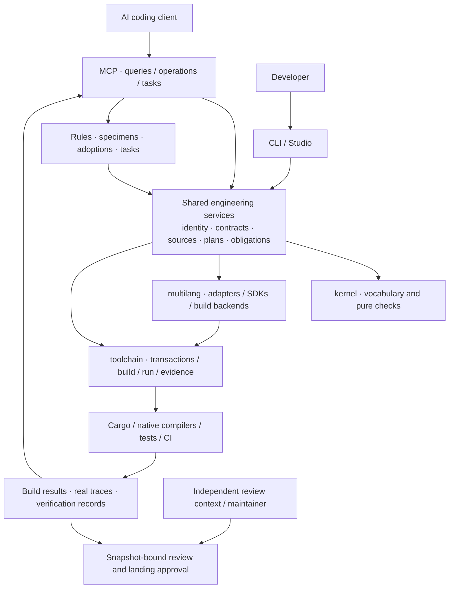

<div align="center">


# XiRang · 息壤

**Turn AI code changes into bounded, composable, verifiable engineering operations.**

Registration contracts · Atomic maintenance operations · Mixed-language builds · MCP

[简体中文](README.zh-CN.md) · [User guide](docs/using-xirang.md) · [Six engineering problems](docs/ai-engineering-workflow.md) · [Extend a language](docs/extending-languages.md)

[](.github/workflows/ci.yml)
[](https://crates.io/crates/xirang-toolchain)
[](LICENSE)

</div>

XiRang is an engineering framework for **mixed-language projects maintained by people and AI agents**. Explicit registrations connect objects, parents, contracts and source ownership. Those facts support creation, migration, grafting, partitioning, verification and durable project knowledge through CLI, Studio and MCP.

People decide what may change and what must hold. Agents work within that structure; compilers, tests and reviewers provide different kinds of evidence. XiRang is intended for component platforms, frameworks and projects maintained across teams. Ordinary helper functions do not each need a registration.

> **The name:** XiRang (息壤) is the self-growing soil of Chinese mythology. New functionality grows from an existing structure, independent implementations can join established contracts, and maintenance knowledge survives the next task.

## Six problems in AI-assisted engineering

| Problem | What XiRang provides | What that establishes |
| --- | --- | --- |
| **No durable project memory** | Object identities, rules, adopted specimens, template lineage and resumable tasks | Decisions retain their basis, version and subject. Changed evidence can lapse an adoption; an AI suggestion does not automatically become policy. |
| **Locally correct, globally broken** | `affected`, `impact` and `converge` combine source relationships, registration structure, contracts and verification plans | Providers, consumers and tests can be investigated together. Unresolved calls and consumers outside the query scope remain obligations. |
| **Missing the load-bearing parts** | Parent rules, admission, capability dependencies, typed contracts and release scope | Essential boundaries become explicit constraints. Unstated business invariants still need to be supplied. |
| **Unrequested refactoring expands the change** | Previews, candidate copies, scope/protected paths, widening approval and transactional landing | Landing checks scope and baseline freshness. Plain MCP does not block shell writes elsewhere; process write restrictions require explicit managed execution. |
| **“It compiles” becomes “it works”** | Separate build/test/observation evidence, durable verification obligations and task closure checks | Compilation does not substitute for behavioral tests. Passing tests establish only what was exercised. |
| **Author and reviewer share the same blind spots** | A review packet containing the original request, acceptance criteria, actual changes and evidence; verdicts bound to its digest | Independent review can block landing. The MCP tool cannot record its own review pass; the host or team must supply a genuinely independent review context. |

These mechanisms are implemented, but their combination is not a proof against every engineering error. See [the six-problem workflow](docs/ai-engineering-workflow.md) for entry points, rejection cases and limits.

## Start here

This page describes the **current checkout**; published packages may lag behind it. Requires Rust 1.96.0+. C++ paths also require a local C++ toolchain.

```sh
git clone https://github.com/Nichtigott/xirang
cd xirang
XIRANG_CHECKOUT="$PWD"
cargo install --path toolchain --features cli,lang-cpp

xirang new my-app --lib --path "$XIRANG_CHECKOUT"
cd my-app

# Preview, then create a Panel that can own children.
xirang face add panel --lang rust --fields '{"needs_registry":true}'
xirang face add panel --lang rust --fields '{"needs_registry":true}' --write
xirang face show src/panel/panel.rs
xirang check
cargo build
xirang explain root/panel --json
xirang studio
```

`--path` names the XiRang checkout, not the new project's destination. Rust-only users can install with `--features cli`. That feature enables four binaries: `xirang`, `cargo-xirang`, `xirang-mcp` and `xirang-studio`. Enabling a language feature does not install its compiler.

**Existing Rust project:** add `xirang-toolchain` from the same source to regular and build dependencies. Call `build_method::run()` in `build.rs` and `run_method::host!()` in the crate root that owns the tree. Preserve existing build work and avoid duplicate module mounts. [Full integration instructions](docs/using-xirang.md#2-接入已有-rust-项目--add-an-existing-rust-project).

## Compose operations, not just file edits


**Atomic operations** means explicit units of maintenance intent that can be previewed and composed. Supported multi-file write paths use transactions and recovery. It does not mean every sequence is one database transaction or that all operations are crash-safe across power loss.

| Intent | Entry | Meaning |
| --- | --- | --- |
| Create or change an object | `face add/edit`; MCP `apply: add/edit/rename` | Resolve parent, language and destination before editing; change only named fields. |
| Add internal structure | MCP `apply: deepen` | Extend a face's parts while retaining its public registration position. |
| Move an object or subtree | MCP `apply: move` | Carry supported references, ledger facts and migration records; distinguish persistent objects from source instances. |
| Substitute an implementation | graft; MCP `apply: cut` | Declare a cut, check the applicable replacement contracts, derive an effective tree. |
| Adopt a confirmed replacement into the base | MCP `apply: promote` | Update the target declaration and retire the cut/record, subject to confirmation and source/rewrite constraints. |
| Change compilation ownership | `xirang crates` | Assign subtrees to generated crates and wire dependencies/facade; the host remains the authoritative source. |
| Remove a tool-generated face | MCP `apply: delete` | Move it into recoverable trash; rewriting handwritten faces requires separate adoption. |

Registration relationships, source locations and compilation ownership are separate dimensions. `StableFaceId` tracks object continuity; `NodeId` identifies a source instance. Moving or renaming can produce a new instance, with the mapping recorded. “Same object” does not mean “every ID stays unchanged.”

Continue in the `my-app` host:

```sh
# Preview an island outside src/.
xirang-mcp --call apply --json '{"action":"add","language":"rust","parent":"root/panel","file":"components/reading/reading.rs","fields":{"module":"reading","kind":"Reading"}}'
# Apply the same request.
xirang-mcp --call apply --json '{"action":"add","language":"rust","parent":"root/panel","file":"components/reading/reading.rs","fields":{"module":"reading","kind":"Reading"},"apply":true}'

# Preview moving it to the root; add "apply":true after reviewing.
xirang-mcp --call apply --json '{"action":"move","node":"root/panel/reading","to":"root","rebind_grafts":true}'
```

Build and verify behavior after applying. The [user guide](docs/using-xirang.md) covers editing, renaming, moving, partitioning and recovery. CLI `xirang move` moves a **production unit directory**, a different operation from moving a registered object.

## Graft: make replacement an explicit engineering choice


Suppose another team maintains a faster button implementation. A graft declares **which compatible implementation should occupy a host slot**, without copying that implementation into the base tree or maintaining a repository fork just to select it.

A typed plan in the host entry can look like this; the replacement package must already be linked as a dependency:

```rust
pub const GRAFTS: &[Graft] = &[
    graft(crate::catalog::control::button::NODE_ID)
        .with(control_button_graft::button_fast::NODE_ID),
];
```

`graft(...)` selects the slot; `.with(...)` selects the implementation. The overlay checks framework, target, admission and applicable contracts, then returns a new effective tree. Slot and implementation identities remain distinct. See the [graft reference](docs/graft.md) for replacement granularity and recorded plans.

**Alongside Git:** Git tracks source versions and their history. Graft expresses an implementation choice within a host contract. The same source revision can produce a base tree and an overlaid tree to verify separately. Implementation development, review and release still use Git.

**Dispatch boundary:** graft does not intercept ordinary `Button::paint()` calls. The current example uses a controlled host entry to consume the binding, invoke the external implementation and record a trace. General automatic dispatch is not implemented. Registration alone does not supply a cross-language ABI.

```sh
# From the XiRang checkout
cargo test -p xirang-example-control-button --test registry
cargo test -p xirang-example-control-button --test graft_behavior
tools/xirang-graft-binding
xirang explain --overlay --path examples/control-button --json
```

These inspect the registry, controlled behavior switching, MCP consumption of a real trace, and a static projection respectively. `binding` describes a declaration; `observed` describes one recorded run. Neither establishes automatic routing of arbitrary methods.

## Mixed languages, shared engineering facts

Rust and C++ refer to the same registered object through the same logical catalog:

```text
crate::catalog::shop::panel::Area::NODE_ID
```

Rust's `crate` is a keyword; C++'s `crate` is a namespace supplied by the generated header. Paths come from **parent identity and registration name**, not a language's source directories. The real [mixed-shop](examples/mixed-shop) example connects:


A face remains where its author put it; partition planning determines which crate compiles it. `tools/xirang-mixed-shop` checks the mixed tree, partition and actual call results, including a negative control that deliberately breaks the C++ implementation.

Read language support by capability:

| Layer | Current entry and scope |
| --- | --- |
| **Declaration authoring** | Rust; optional C++, Python, C, Zig, JS, TS, Go, Java and C# adapters. `xirang face languages` reports the fields actually enabled in your binary. |
| **Host registration** | Generated Rust trees, native object records and `[record]` file producers. SDKs and hosts live in [examples](examples); combinations have separate gates. |
| **Production builds and delivery** | Backends and action plans for `xirang.toml`; inspect `xirang languages`. A build backend and a registration adapter are separate capabilities. |
| **Call semantics** | Rust `syn`, C++ clang and Python AST feed shared facts. Authoring support for another language does not imply a callgraph backend. |

Try a standalone C++ production project:

```sh
xirang new math-kit --lang cpp --lib
cd math-kit
xirang plan --json
xirang build
xirang test
xirang report
```

The [production guide](docs/using-xirang.md#production) covers dependencies, locking, packaging, installation and rollback. Cross-language calls are limited to the supported ABI/type combinations; a shared registry does not erase language ownership, type or threading rules.

## Where MCP fits



MCP exposes engineering services to agents; compilers, behavioral tests and human decisions retain their roles. CLI, Studio and MCP share relevant facts and services but expose different capabilities. For example, MCP's production surface reads inventories, plans and reports; it does not run those builds.

Typical stdio client configuration; substitute absolute paths and use your client's wrapper format:

```json
{
  "mcpServers": {
    "xirang": {
      "command": "/absolute/path/to/xirang-mcp",
      "env": {"XIRANG_PACKAGE_ROOT": "/absolute/path/to/my-app"}
    }
  }
}
```

Start with `xirang.explore` for current source and responsibility context, `xirang.apply` for structural changes, and `xirang_tools` to discover additional capabilities:

```json
{"tool":"candidate"}
```

Supplying only `tool` reads its schema; add `arguments` to invoke it. The maintenance path is **context and rules → bounded scope → preview → candidate work → behavioral verification → independent review → approved landing → knowledge and task closure**. See [MCP examples](docs/using-xirang.md#mcp) and [the engineering workflow](docs/ai-engineering-workflow.md).

For people, `xirang studio` exposes face authoring (`a/e/d`), graft records (`g`), search (`/`) and build checks (`b`); follow the current page's help. [Actual TUI capture](picture/xirang-studio-current.webp) · [capture provenance](picture/README.md).

## Why XiRang alongside CodeGraph?

CodeGraph already uses syntax trees, symbol resolution and call relationships. XiRang's distinction is **connecting declared engineering intent to executable maintenance operations**, beyond understanding source.

| Need | Additional XiRang facts and operations |
| --- | --- |
| Find a method and its callers | Source relationships can be accompanied by registration ownership, contracts, graft declarations and available runtime evidence. |
| Decide whether a change is allowed | Explicit parent rules, capability requirements, admission and applicable maintenance rules supplement inferred relationships. |
| Replace, move or split | Graft, move and crates express separate intents, with corresponding identity, reference and build bookkeeping. |
| Pass knowledge to the next agent | Adoptions, rules, specimens and tasks retain evidence and invalidation conditions; subsequent tasks re-evaluate them. |
| Control delivery | Candidate scope, protected content, verification plans, review packets and landing approvals form an inspectable workflow. |

**The evidence does not establish an overall win.** In the [2026-11-01 comparison](docs/two-arm-results-2026-11-01.md), the 15-query evidence-item score was 43/43 versus 37/43, with longer XiRang replies. Both arms succeeded in the six-session pilot; XiRang's aggregate cost-equivalent was **1.19×** CodeGraph's. The comparison used CodeGraph 1.6.1; versions and apparatus differ between experiments. The new formal 18-session run did not successfully execute. Evidence-item coverage is neither callgraph accuracy nor model repair success.

Choose XiRang when you need **registration contracts, structural operations, mixed builds and maintenance evidence to work together**. Source-indexing tools remain valuable for exploring an arbitrary existing repository.

## Extend a language

```sh
# In a XiRang checkout: preview only.
xirang lang new mylang --extension ml --checkout .
# Write scaffolding and feature/registry wiring; implementation is still required.
xirang lang new mylang --extension ml --checkout . --apply --register
```

Extensions live under `multilang/src/languages/<language>/`, SDKs under `multilang/sdk/<language>/`. Reuse the language kit's grammar, planning and record components; implement `LanguageAdapter`, then add a record producer, semantic provider or production backend where needed. A language within the existing protocol does not need language-specific branches in the pure kernel.

A scaffold is not a working language. Prove source round trips, real builds, runtime registration and refusal cases. A missing toolchain means unverified, not supported. See [the extension guide](docs/extending-languages.md).

## What adoption asks of you

Choose meaningful registration boundaries, declare parents and contracts, wire the host build, and supply behavioral tests. Business functions remain ordinary language code. Tool-managed declarations, handwritten source and generated crates have different write policies; generated crates are not an independent source of truth.

XiRang applies the same discipline to itself: pure rules in [kernel](kernel), execution in [toolchain](toolchain), language implementations in [multilang](multilang). Concrete failures become regression tests; mechanically checkable conventions live in [conventions](conventions). Decisions and historical evaluations remain in [docs](docs). Standards become durable through explicit decisions and negative tests, not repeated model self-approval.

## Verify and contribute

```sh
cargo fmt --all -- --check
cargo test -p xirang-conventions --offline
cargo test --workspace --offline
cargo clippy --workspace --all-targets --offline -- -D warnings
cargo clippy --workspace --all-targets --offline --all-features -- -D warnings
tools/xirang-publish --check-table
tools/xirang-test
```

`--offline` assumes cached dependencies; a cold environment needs to fetch them first. `xirang-test` discovers feature faces from manifests and reports tests reached by none of them. Real-host rehearsals include [island-loop](tools/xirang-island-loop), [mixed-shop](tools/xirang-mixed-shop), [partition-rehearsal](tools/xirang-partition-rehearsal) and [API compat](tools/xirang-api-compat). A script's existence is not a pass for the current worktree: acceptance belongs to a particular run and snapshot.

Contributions of real use cases, minimal failures, language adapters and compatible implementations are welcome. Include success and failure paths, and say what you verified. [Repository rules](AGENTS.md) · [Issues](https://github.com/Nichtigott/xirang/issues) · [Discussions](https://github.com/Nichtigott/xirang/discussions) · [MIT](LICENSE)
