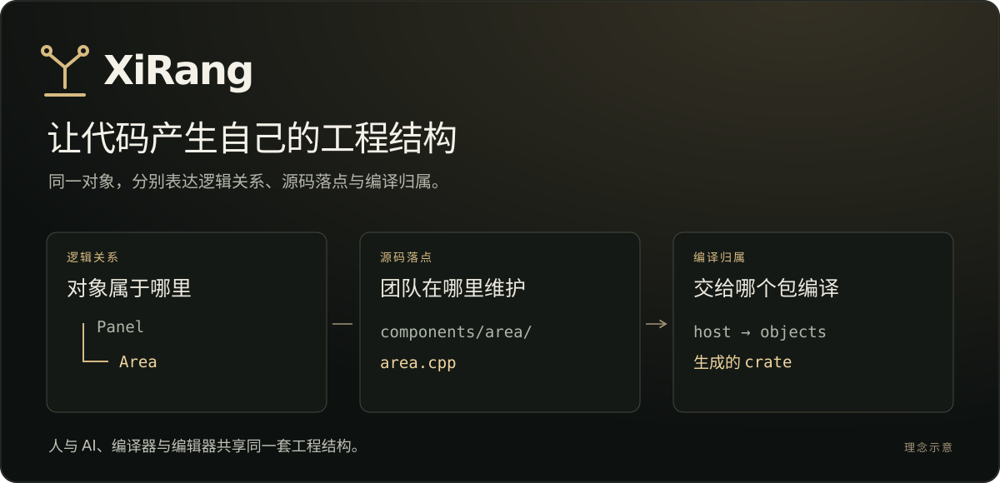
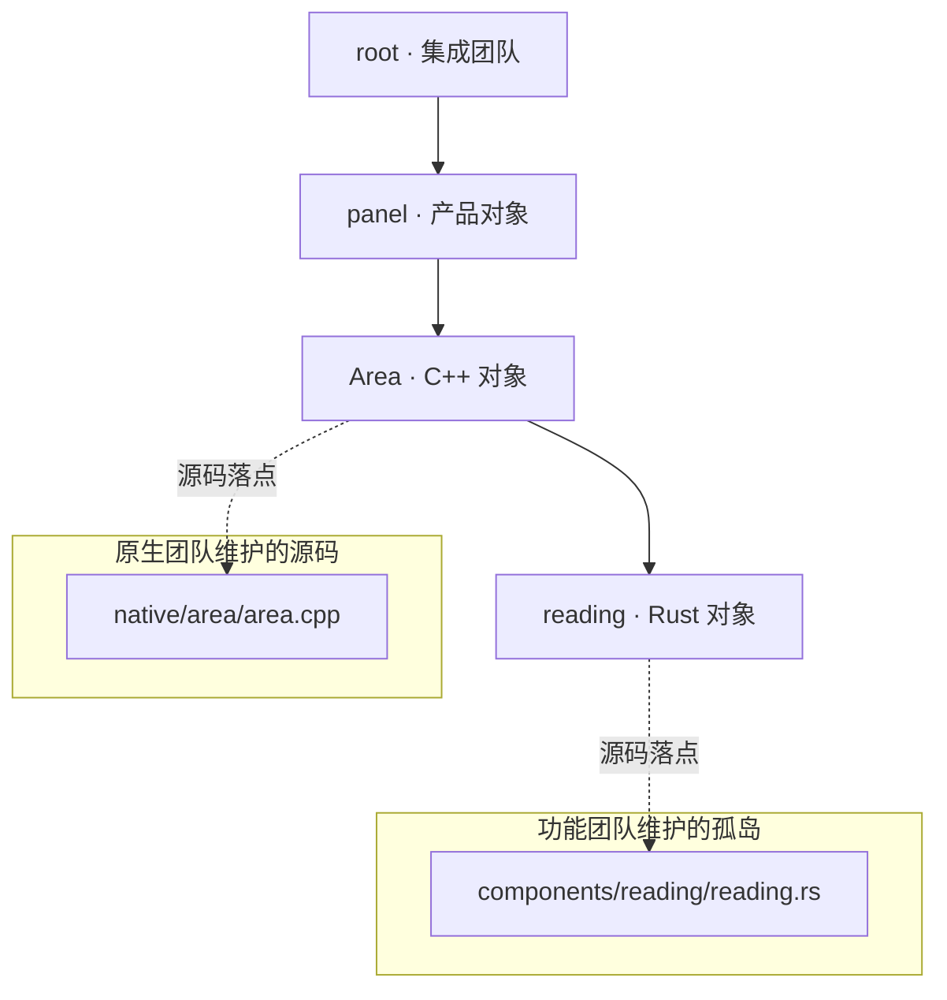
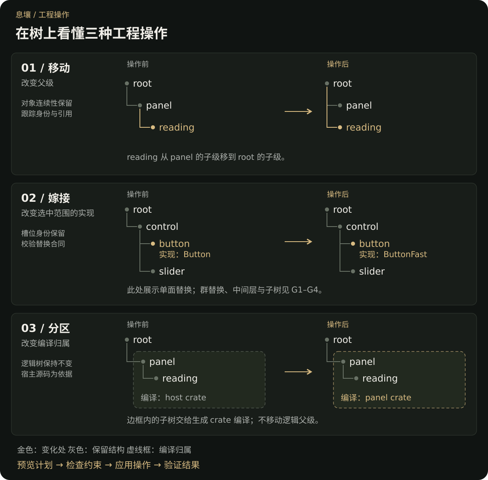
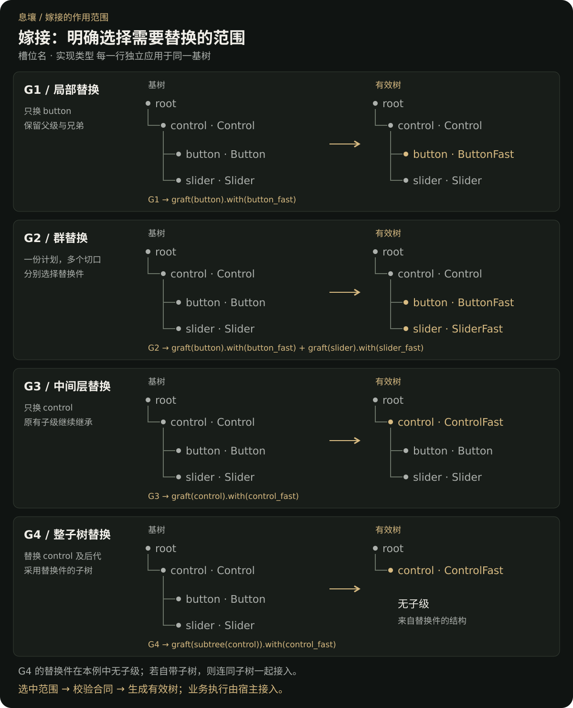
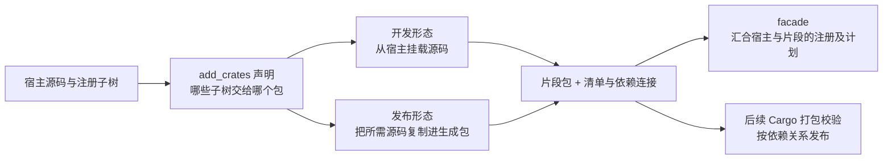
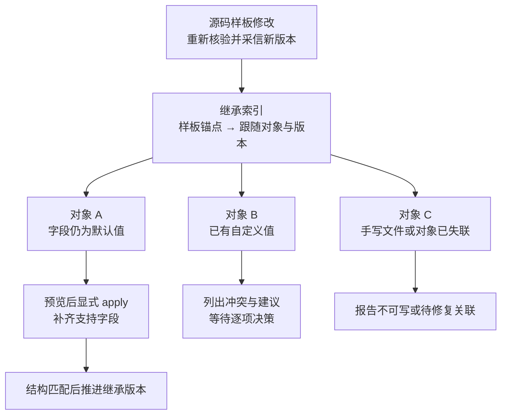
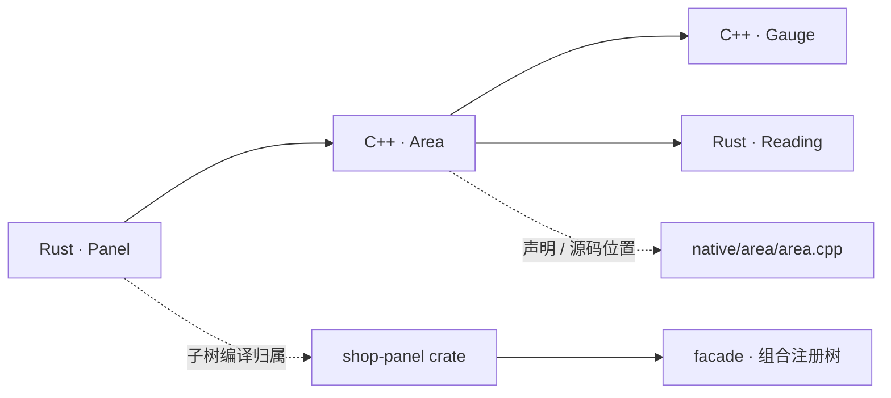
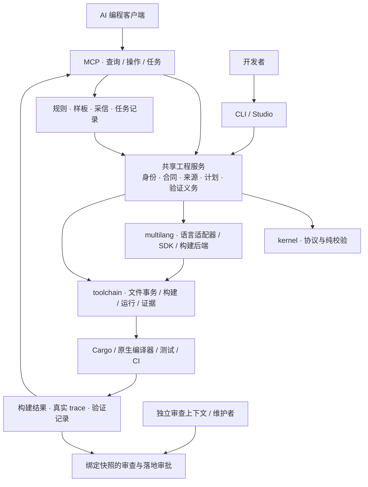

<div align="center">


# XiRang · 息壤

**以被动式注册自组织为核心的原子化项目管理框架。**

被动注册自组织 · 孤岛协作 · Graft 灵活组合 · add_crates 打包后置 · 混合语言 / AI

[English](README.md) · [使用指南](docs/using-xirang.md) · [六类问题与实现](docs/ai-engineering-workflow.md) · [扩展语言](docs/extending-languages.md)

[](.github/workflows/ci.yml)
[](https://crates.io/crates/xirang-toolchain)
[](LICENSE)

</div>

息壤是一套**以被动式注册自组织为核心的原子化项目管理框架**，面向人与 AI 共同维护的混合语言工程。对象在源码旁声明自身身份、父级与合同，由构建发现与校验形成工程对象树，让项目从自己的声明中产生结构信息。

在这套自组织结构上，**孤岛将源码落点与逻辑层级分开，支持团队按职责维护实现；graft 提供实现替换与组合的灵活性，add_crates 将编译与交付包的组织后置**。你可以先按业务与工程关系组织代码，再决定如何划分 crate，减少为未来拆包预先安排源码、或反复调整包边界的心智负担。MCP、CLI 与 Studio 使用同一套结构事实与操作入口。

开发者决定“什么可以改变、什么必须保持”；AI 在这个结构里提出和执行改动，编译器、测试与审查分别提供证据。它适合组件平台、框架和多团队维护的工程；不要求把每个辅助函数都注册成对象。

> **息壤**是中国神话里能不断生长的土壤。这里的含义是：新功能能从既有结构中生长，别人的实现能接入已有合同，而维护经验能留给下一次任务。

**阅读路线：** [核心理念](#model) → [被动式注册自组织](#passive-registration) → [孤岛与团队协作](#islands) → [原子操作总览](#operations) → [graft 灵活组合](#graft-scopes) → [add_crates 打包后置](#crate-packaging) → [项目记忆与模板演进](#project-memory) → [使用演练](#usage)。

<a id="model"></a>
## 核心理念：围绕明确边界，灵活组合项目，让项目自己产生结构信息

**先按工程逻辑组织代码，让结构从声明中形成；再选择实现组合与打包方式。** 息壤把项目的组织关系、采用的实现和交付包边界分开表达，让后两者能够随需求演进，减少对源码组织的反复调整。

| 层次 | 核心能力 | 回答的问题 |
| --- | --- | --- |
| **结构基础** | 被动式注册自组织 | 项目有哪些对象，属于谁，遵守什么边界？ |
| **源码与团队组织** | 孤岛与来源映射 | 各团队在哪里维护源码，怎样接入共同的对象树？ |
| **实现组合** | graft 嫁接 | 哪些位置需要替换，用什么实现，保留哪些部分？ |
| **打包组织** | add_crates 分区 | 哪些工程单元一起编译，怎样组成交付包？ |



这些能力共同解耦**项目组织与项目打包**：开发者先关注对象职责和关系，包边界通过后续声明表达。它降低的是为拆包反复搬动源码、维护接线的负担；语言的可见性、依赖关系和合同仍需成立。

<a id="passive-registration"></a>
### 被动式注册自组织：让项目产生自身结构

每个对象在自己的源码旁声明父级与合同；构建器在支持的发现范围内收集声明、解析身份并校验关系，形成注册树。**父对象无需手工维护一份子对象清单**，新增对象通过自身声明加入工程结构。

“被动”指父级不逐个主动收集子对象；“自组织”指结构由分散的声明及其关系装配而成。作者声明业务意图与必须遵守的合同，工具从声明和源码关系中生成、分析结构事实；已有调用关系无需再手工抄写成另一份清单。项目变化时，这些事实可重新计算，并成为影响分析、维护操作和项目记忆的共同依据；未解析调用仍需明确标为未知。

**注册树表达工程对象关系。** 一个对象可以位于独立源码目录、由另一门语言实现，或交给另一个 crate 编译。逻辑位置、源码位置与编译归属分别记录，让代码组织不必预先等同于 crate 的划分。

| 概念 | 在树中表达什么 | 为什么需要它 |
| --- | --- | --- |
| 对象与注册面 | 具有身份、父级和合同的工程单元 | 把源码、规则、影响分析与维护记录关联到明确对象。 |
| 槽位与实现 | 宿主要求的位置，以及承担这个位置的实现 | 可以保持宿主边界，单独选择满足合同的替换件。 |
| 来源与编译归属 | 实现由谁维护、由哪个包编译 | 源码位置、逻辑层级和拆包不必捆绑改变。 |
| 规则与证据 | 哪些变更允许，完成需要哪些验证 | 项目知识能被下一次任务读取，也能检查是否仍然有效。 |

实际工作按 **读取上下文 → 确定范围 → 预览操作 → 实施 → 验证 → 独立审查 → 沉淀知识** 推进。调用图帮助判断影响；注册合同提供显式边界；MCP 把这些事实和动作交给 AI。三者共同服务维护流程。

<a id="islands"></a>
### 孤岛与团队协作：源码各有归属，工程关系共同组织

**孤岛是默认发现布局之外、通过显式映射接入注册树的源码落点。** “孤岛”独立的是源码位置，仍然通过身份、父级和合同参与共同的工程结构。一个团队可以维护 `components/reading/`，另一个团队维护 `native/area/`；两者无需为了在逻辑树中成为父子而搬进同一目录，也无需先拆成独立 crate。

下图是一种团队分工示意：实线表示逻辑父子关系，虚线表示源码归属。团队名称是协作约定，不代表系统自动授予访问权限。



**分工可以围绕对象展开：** 实现团队维护源码与合同；集成团队通过 graft 选择兼容实现，再用 add_crates 决定编译与交付边界。独立实现可以作为外部包维护，孤岛则让宿主内的源码组织不必复制逻辑层级。两者配合，使团队目录、对象树和交付包各自按需要演进。

来源声明 `xirang.sources.tsv` 可随项目共享；`.xirang/source-bindings.tsv` 保存本机的来源根绑定。同一个来源标识可以对应不同机器上的检出位置，进入宿主时仍须满足来源解析与包内落点规则。缺失或越界的来源会被拒绝；能读取外部来源不等于获得修改它的权限。[使用步骤 3](#use-move)演示孤岛创建与移动，[来源映射指南](docs/using-xirang.md)说明共享声明与本机绑定。

#### 多成员如何协作：交接对象、候选改动与证据

同一工程可以由多位开发者和多个 Agent 分工维护。每位成员先读取自己负责对象的规则、样板与影响范围，在候选副本中实施变更；评审者收到原始需求、实际差异与验证证据，维护者决定是否落地。下一位成员通过持久任务恢复上下文，无需依赖上一段聊天记录。


| 成员 | 使用入口 | 交接给下一位的内容 |
| --- | --- | --- |
| 实现者与作者 Agent | CLI / Studio 创作；MCP 查询与候选操作 | 责任对象、候选修改、验证结果 |
| 独立评审者 | 宿主提供的 review packet | 绑定当前包摘要的评审结论 |
| 维护者与集成人员 | 宿主审批入口、graft、add_crates | 被接纳的改动、实现组合与交付边界 |
| 后续接手者 | `task status/resume`、规则与采信查询 | 仍有效的依据、过期项与未完成验证 |

这些角色由团队或宿主编排。候选落地会核验支持范围内的改动与基线；它不代替 Git 合并，也不提供多人实时共编。独立审查需要团队配置独立上下文与权限。[可执行团队演练](docs/ai-engineering-workflow.md)提供候选、验证、审查与落地请求。

#### 远程协作：把构建与验证交给 worker

多团队还可以通过 `xirang remote` 把多语言生产项目的构建、测试交给 worker，并查询证据、取回产物。CLI 提供命令传输与 `--ssh` 预设，以及超时、重试和多项目并发选项；MCP 的生产查询入口让 AI 读取计划与报告，执行由 CLI 或 CI 承担。

**源码准备与任务执行分别安排。** 当前 remote 发送项目绝对路径，不自动上传源码；SSH worker 需要安装息壤与对应工具链，并在相同绝对路径准备一致的项目和依赖，或由自定义传输适配路径。孤岛本身也不提供仓库同步。[远程使用示例](docs/using-xirang.md#remote-workers)给出本机协议试跑与 SSH 用法。

<a id="operations"></a>
## 原子操作总览：创建、移动、嫁接、分区与落地

在被动注册形成的对象树上，创建、移动、嫁接和分区分别处理对象生长、逻辑位置、实现选择与编译归属。先从下图看它们如何改变项目，再展开 graft 与 add_crates 的使用理念。每个操作表达一个明确意图，组合时仍需满足各自的前置条件。



这里的**原子化**指把维护意图拆成明确、可预览和可组合的操作。涉及多个文件的支持路径使用事务恢复；不表示任意操作序列都是一个数据库事务，也不承诺断电后的全局原子性。

| 意图 | 操作 | 关键语义 |
| --- | --- | --- |
| 增加或调整对象 | face add/edit；MCP apply: add/edit/rename | 先解析父级、语言和落点，再产生修改；编辑只改点名字段。 |
| 给对象加一层内部结构 | MCP apply: deepen | 扩展内部 parts，保留对外注册位置。 |
| 移动对象或子树 | MCP apply: move | 同步支持范围内的引用、台账和迁移记录；稳定对象与源码实例身份分开处理。 |
| 局部、群组、中间层或子树替换 | graft 计划（G1–G4） | 选定范围与替换件，校验合同，生成有效树；见 G1–G4。 |
| 将确认后的替换落入基树 | MCP apply: promote | 显式确认后更新目标声明、退役切口与记录；有来源和可重写条件。 |
| 调整编译归属 | xirang crates | 把子树交给生成 crate，连接依赖与 facade；权威源码仍在宿主。 |
| 删除工具生成的面 | MCP apply: delete | 进入可恢复的 trash；手写面改写需要另行接管。 |

注册关系、文件位置、编译归属是三个维度。`StableFaceId` 记录对象连续性；`NodeId` 标识源码实例，移动或改名可能产生新实例，工具记录映射。不能把“对象仍是同一个”误写成“所有 ID 都不变”。

<a id="graft-scopes"></a>
### graft：让代码具备社区性与组合空间

**graft 是息壤项目管理的核心能力之一，建立在被动式注册自组织之上。** 你可以接入另一团队的局部实现，替换中间层并保留现有子对象，或为一组位置统一接入同一份兼容实现，也可以分别选择不同实现。实现提供替换内容，嫁接计划声明替换位置与范围；合同检查决定这种组合能否成立。

**设计初衷：让使用息壤的代码本身拥有社区性。** 开发者可以围绕某个对象或层级维护自己的实现，其他人按需接入、试用、比较，再与其他兼容实现组合。贡献既可以进入上游，也可以作为独立实现持续维护；宿主通过选择实现参与这种协作。局部优化、实验性方案和不同风格因而有机会共存，增加项目的可玩性与探索空间。

嫁接可以作用于叶子、多个槽位、中间层或整个子树。它将**选中的基树位置**交给外部实现，校验后生成一棵有效树；基树与外部树保持原样。下图每一行都是从同一基树出发的独立方案，不是连续执行的四步。



| 图中编号 | 选择范围 | 子级如何处理 |
| --- | --- | --- |
| **G1 局部替换** | 一个面，例如 button | 父级与兄弟保持；若目标有子级，默认继承原子级。 |
| **G2 群替换** | 一份计划放多个切口，可分别指定实现；连续兄弟还可用 `range(a, b)` | 每个普通切口保留自己的原子级；区间形式给区间内每个槽位使用同一替换件，不合并成一个槽位。 |
| **G3 中间层替换** | 一个带子级的面，例如 control，使用普通 `graft(control)` | 保留原子级；替换件必须能承接它们，其规则与合同不兼容时拒绝。 |
| **G4 整子树替换** | `graft(subtree(control))` | 原后代退出这棵有效树，接入替换件自带的子树；替换件无子级时结果就是叶子。 |

“中间层”描述切口的位置，不是另一套 API。**普通 graft 换选中的面，`subtree` 显式改变后代的继承方式。** 多切口计划校验通过才返回有效树；群替换不是按方法名做全局搜索替换。

#### 替换边界：已有依赖与行为证据也必须考虑

外部代码已经如何使用某个对象，也是替换时必须考虑的约束。作者写出的声明可能不完整，因此边界分析需要同时使用注册合同、源码调用关系和运行证据。当前工具能够查询影响关系；graft 会解析选中范围、检查已声明的输入／输出合同、目标规则、准入与连接关系，并在保留子级时检查替换件是否仍能承接它们。

**自动边界保护的设计方向**是：识别切口外部的消费者，确定必须保留的接口，采集可复现的原实现行为基线，形成规则与验证义务；完成所要求的兼容性测试后，才允许接受替换。原实现的返回值只是特定输入与环境下的样本，需要明确哪些行为必须保持、哪些变化是允许的。

**当前实现边界：** 本检出尚未将“自动发现全部外部调用、保留相应函数及原返回值、生成 rule、强制行为测试”接成通用 graft 流程。`overlay` 的合同校验不会自动执行业务测试；MCP `check` 执行所选验证计划，其通过范围取决于实际运行的检查。使用时应把消费者兼容测试接入验证流程，不能把结构校验通过当作行为保持的证明。

**为什么不只用 Git 分支？** Git 管理源码版本；graft 在同一版本中表达可组合的实现选择。团队可以分别维护兼容实现，在宿主合同下比较基树与不同有效树，无需为了每种组合复制整个项目。

**结构替换如何影响运行？** 宿主要消费有效树或绑定记录，将其接入实际执行入口。graft 不会自动拦截普通 `Button::paint()`；当前示例已验证受控入口中的真实调用与 trace，通用自动分派未实现。[使用步骤 4](#use-graft)按 G1–G4 给出计划与运行方法。

<a id="crate-packaging"></a>
### add_crates：将打包组织后置

**面对按对象或子树灵活组合、拆分交付的需求，现有 crate 打包方式仍不够灵活。** Cargo 已有 workspace、依赖和 feature 机制，但调整包边界通常仍需要手动维护清单、模块路径、可见性和跨包引用。开发时方便维护的源码组织，也未必正好是交付时需要的包结构。

息壤的 **`add_crates` 分区机制致力于解耦项目组织与打包组织，把包划分作为后置决策**：先声明哪些子树由哪个 crate 编译，再由工具生成包结构与依赖连接。一个生成 crate 可以认领多棵不重叠子树；逻辑对象树与权威源码不必跟着每次拆包重新组织。CLI 入口是 `xirang crates`，分区声明保存在 `add_crates.rs`。



| 阶段 | add_crates 做什么 | 得到什么 |
| --- | --- | --- |
| **声明与规划** | 读取子树选择、构建事实和宿主 graft 计划，检查划分，计算落点与依赖 | 可以预览的编译归属与生成包计划；此时还没有发布包。 |
| **开发形态** | 生成片段 crate，从宿主挂载对应源码，并连接 workspace、宿主依赖与所需重导出 | 继续维护一份宿主源码，按规划的 crate 边界编译。 |
| **发布形态** | 将片段需要的源码复制到包内，生成针对包内源码的构建入口，携带身份命名空间与 graft 切口 | 片段的源码不再依赖开发时的包外挂载；facade 汇合宿主和片段，不复制一份完整实现。 |
| **打包与发布** | 分区视图列出包间依赖与发布阻碍；随后按 Cargo 规则核验包内容、依赖版本与构建 | 完成相应检查后才可发布。`--release` 生成发布形态，不等于已执行 `cargo publish`。 |

**与 graft 配合：** graft 决定哪些位置采用什么实现，add_crates 决定这些工程单元怎样组织成编译与交付包。拆包时继续携带宿主身份与 graft 计划，避免仅仅改变编译归属就丢失实现选择。

目前这套机制仍以**显式子树划分和支持的引用连接**为边界，不会自动把任意函数集合拆成包，也不会自动消除循环依赖或完成全部发布配置。生成目录仍是产物，修改应回到宿主源码；发布形态重生成会重新复制源码。项目持续维护中，add_crates 的方向是让源码组织、实现组合与打包边界更独立，同时保持可检查的依赖与身份。[使用步骤 5](#use-partition)展示从开发形态转到发布形态的流程。

<a id="project-memory"></a>
## 项目记忆：分层保存依据，把结构经验用于下一次改动

**项目记忆既回答“这个项目怎样组织”，也记录“哪些对象沿用了哪一版结构”。** 它由工程事实、已接受的规则、模板继承关系和任务证据共同组成；读取时按对象与适用范围关联，变化后重新核验依据。

| 层次 | 保存在哪里 | 下一次工作怎样使用 |
| --- | --- | --- |
| **工程结构与接口** | 源码旁的注册声明、合同、catalog 与对象台账 | 确认对象归属、接口约束、来源及历史位置。 |
| **规范与采信依据** | `.xirang/rules/`、`.xirang/adopted/entries` | 读取适用规则及其版本、来源和文件指纹；失效的采信需重新确认。 |
| **样板与继承关系** | 已采信的源码样板、`.xirang/templates/lineage.tsv` | 记录“对象 → 样板锚点 → 已跟随版本”，定位需要迁移的跟随者。 |
| **工作与验证记录** | `.xirang/tasks/`、持久验证计划与日志、候选审查包 | 接续未完成工作，重新检查验证、规则与知识义务。 |

### 模板演进：一次修改，按继承索引规划多处迁移

新增对象时，工具按父级与 kind 寻找有效样板，并记录继承版本。以后调整已采信样板，可以用 `refactor` 枚举跟随对象、比较结构并生成迁移计划。**它减少的是逐文件寻找同类结构、重复补字段和追踪迁移进度的工作。**



当前可机械迁移的是 **`preset`、`parts` 中仍为默认值的字段**，通过已有 `edit` 路径逐对象执行。自定义值、模板删除的值、手写文件及缺少测试入口等情况会列出差异或建议；谱系保存版本而非旧模板全文，因此旧模板曾复制下来的非默认值与后来主动定制的值无法区分，都会要求决策。不会自动覆盖业务逻辑，也不会根据模板搬动目录或改名。**保存模板本身不会触发全项目改写**：新版本需有效采信，迁移需显式执行；各对象分别推进，不承诺全项目一次事务。

在已有模板继承记录的宿主根目录，先查询迁移计划：

```sh
xirang-mcp --call refactor --json '{}'
```

确认适用范围并重新采信修改后的样板后，可只处理该锚点；将示例值替换成计划中实际返回的 anchor：

```sh
xirang-mcp --call refactor --json '{"anchor":"REPLACE_WITH_TEMPLATE_ANCHOR","apply":true}'
```

完成后运行相关构建与行为测试，再检查剩余冲突。这样可以按共同样板推进项目级结构演进；任意代码重构与整项目性能收益仍需具体迁移方案和测量。[记忆机制与边界](docs/ai-engineering-workflow.md)、[规则与任务用法](docs/using-xirang.md#knowledge)。


## 为什么需要它：六类 AI 工程问题

| 问题 | 息壤提供的机制 | 得到什么；保证到哪里 |
| --- | --- | --- |
| **项目知识难以持续积累与复用** | 对象身份、规则簿、已采信样板、模板继承记录、可恢复任务 | 记住依据、版本和适用对象；源码变化会让相关采信失效。不是聊天摘要，也不自动把 AI 建议升级成规范。 |
| **局部变更缺乏全局影响约束** | `affected` / `impact` / `converge` 联合源码关系、注册关系、合同与验证计划 | 追踪提供者、消费者和测试；未解析调用与范围外消费者仍是待核验项。 |
| **关键架构约束难以识别** | 父级规则、准入、能力依赖、类型合同、发布作用域 | 把必须保持的结构写成显式约束，减少只看引用次数的猜测；未声明的业务不变量仍需团队补充。 |
| **变更范围缺乏有效控制** | 操作预览、候选副本、scope / protect、扩围审批、事务落地 | 候选落地检查越界与过期基线；普通 MCP 不阻止其他 shell 写入，进程写域需显式托管执行。 |
| **构建结果与功能验收脱节** | 区分 build / test / 运行证据，持久验证义务，任务关闭检查 | 编译成功不抵充行为测试。验证只覆盖实际执行的用例，不证明未测行为。 |
| **开发与审查缺乏独立性** | 原始需求、验收条件、实际改动和验证证据组成审查包；判定绑定包摘要 | 可要求独立审查后才落地；MCP 工具不能给自己写 review pass。真正独立的审查上下文由宿主或团队提供。 |

这些机制已有实现，但组合起来不等于自动解决所有工程错误。逐项入口、反例与边界见[六类问题的工程闭环](docs/ai-engineering-workflow.md)。

## 混合语言：同一工程事实，各自的语言工具链

Rust 和 C++ 对同一个注册对象使用同一逻辑目录：

```text
crate::catalog::shop::panel::Area::NODE_ID
```

Rust 的 crate 是语言关键字；C++ 的 crate 是生成头提供的命名空间。路径来自**父级身份与注册名**，而非各语言的源码目录。下面是真实 [mixed-shop](examples/mixed-shop) 的关系：



面留在作者的源码位置；分区规划决定谁编译它。`tools/xirang-mixed-shop` 检查真实混合树、分区和调用结果，并包含故意改坏 C++ 实现的反面控制。

语言支持按层阅读，不能用“支持某语言”代替全部能力：

| 层 | 当前入口与范围 |
| --- | --- |
| **声明与创作** | Rust；可选适配器 C++、Python、C、Zig、JS、TS、Go、Java、C#。用 xirang face languages 查看当前二进制实际启用的字段。 |
| **进入宿主注册树** | Rust 生成树、原生对象记录、[record] 文件生产者。各语言 SDK 和宿主在 [examples](examples)；组合能力按相应门禁验收。 |
| **生产构建与交付** | xirang.toml 的后端和动作计划，查询 xirang languages。构建后端与注册适配器是两种能力。 |
| **调用语义** | Rust syn、C++ clang、Python AST 接入共同事实；其他语言的创作支持不意味着已有调用图后端。项目持续维护中，后续将逐步补充更多语言的调用图后端。 |

## MCP 如何接入整个工程



MCP 把工程服务交给 Agent；它不承担编译器、业务测试和人的决策。CLI、Studio 与 MCP 共用相关事实和服务，但各入口支持的操作范围不同，例如 MCP 的多语言生产入口只读清单、计划与报告。

## 和 CodeGraph 相比，优势在哪里？

CodeGraph 已有语法树、符号解析和调用关系能力。息壤的差异是：**在代码理解之外，把明确的工程意图连接到可执行维护操作。**

| 需求 | 息壤增加的工程事实和操作 |
| --- | --- |
| 找到一个方法和它的调用者 | 查询源码关系，同时可返回注册归属、合同、graft 声明和已有运行证据。 |
| 判断一个改法是否允许 | 根据已声明的父级规则、能力要求、准入与适用维护规则检查，而不只推测代码关系。 |
| 换实现、搬对象、拆包 | 用 graft / move / crates 表达不同意图，维护各自的身份、引用和构建事实。 |
| 把经验交给下一位 Agent | 分层保存规则、采信、模板继承与任务；按索引规划跟随对象迁移，后续任务重查依据。 |
| 控制 AI 的交付 | 候选范围、受保护内容、验证计划、审查包和落地批准形成可检查的流程。 |

**已有对照不支持“全面胜出”。** [2026-11-01 对照报告](docs/codegraph-comparison.md)中，15 题的证据项覆盖为 43/43 对 37/43，但息壤回复更长；6 会话 pilot 两臂均机械成功，息壤成本当量合计为 CodeGraph 的 **1.19 倍**。对照为 CodeGraph 1.6.1，工具版本和装置口径见报告；正式 18 会话新版实验未运行成功。证据项覆盖不是调用图准确率，也不是模型修复成功率。

选择息壤的理由是需要**注册合同、结构操作、混合构建和维护证据之间的连接**。仅需阅读任意现有仓库时，代码索引工具已经很有价值。

## 接入要付出什么

你需要选择有工程意义的注册边界，声明父级与合同，接入宿主构建，并提供行为测试。普通业务函数仍按原语言编写。受工具管理的声明、手写源码、生成 crate 各有写入规则；生成 crate 不能作为另一份权威源码独立维护。

息壤自身也按这个方式演进：纯规则放在 [kernel](kernel)，I/O 与进程绑定放在 [toolchain](toolchain)，语言实现放在 [multilang](multilang)。具体缺陷形成回归测试，可机械判断的约定进入 [conventions](conventions)；维护决定与历史评测保留在 [docs](docs)。规范的固化依赖明确决策和反面测试，不能靠模型反复自我确认。

<a id="usage"></a>
## 使用：按图完成一次工程操作

以下分为一个连续的创建／移动流程，以及独立的嫁接、分区和混合语言演练。每节说明工作目录、输入和要检查的结果；不要把不同宿主的路径混用。

### 1. 安装并创建第一棵树

本页面向**当前源码检出**；发布包可能晚于这里介绍的能力。需要 Rust 1.96.0+；C++ 路径还需要本机 C++ 工具链。

```sh
git clone https://github.com/Nichtigott/xirang
cd xirang
XIRANG_CHECKOUT="$PWD"
cargo install --path toolchain --features cli,lang-cpp

xirang new my-app --lib --path "$XIRANG_CHECKOUT"
cd my-app

# 先看计划，再创建一个能容纳子对象的 Panel。
xirang face add panel --lang rust --fields '{"needs_registry":true}'
xirang face add panel --lang rust --fields '{"needs_registry":true}' --write
xirang face show src/panel/panel.rs
xirang check
cargo build
xirang explain root/panel --json
```

`--path` 指向息壤检出，不是新项目的目的地。纯 Rust 用户可安装 `--features cli`。cli 同时启用 xirang、cargo-xirang、xirang-mcp、xirang-studio 四个入口；语言 feature 不会替你安装对应编译器。

**接已有项目：** 在普通依赖和构建依赖中加入同来源的 xirang-toolchain，在 build.rs 调用 `build_method::run()`，在拥有注册树的 crate 根调用 `run_method::host!()`。保留已有构建工作，避免重复挂载同一模块。[完整接入步骤](docs/using-xirang.md#2-接入已有-rust-项目--add-an-existing-rust-project)。

### 2. 读懂注册声明

注册面就是放在普通实现代码旁的一份声明。下面说明一个 Button 子面的声明形状；这一段用于阅读，不需要手工粘贴到前面生成的 Panel 文件中：

```rust
#[xirang_toolchain::soil]
pub const SOIL: xirang_toolchain::Soil = xirang_toolchain::Soil::of::<Button>()
    .under(crate::catalog::panel::NODE_ID)
    .exports(&["panel.render"]);

pub struct Button;
```

它声明父级和导出元数据，没有替你实现渲染。宿主需要的类型合同和业务行为仍要编写。构建器收集声明，父对象不必维护一份子对象名单。[名词解释：Soil、Registry、catalog、graft、fragment](docs/using-xirang.md#vocabulary)。

<a id="use-move"></a>
### 3. 创建子面，再移动到根级（操作图 01）

对照[操作图 01](#operations)，在步骤 1 的 my-app 根目录执行。先建立图中的 `root/panel/reading`，再将 reading 提升到 root；源码放在 src/ 外，逻辑父级仍然明确。

```sh
# 创建：预览，再执行。
xirang-mcp --call apply --json '{"action":"add","language":"rust","parent":"root/panel","file":"components/reading/reading.rs","fields":{"module":"reading","kind":"Reading"}}'
xirang-mcp --call apply --json '{"action":"add","language":"rust","parent":"root/panel","file":"components/reading/reading.rs","fields":{"module":"reading","kind":"Reading"},"apply":true}'
cargo build
xirang explain root/panel/reading --json

# 移动：预览，再执行。
xirang-mcp --call apply --json '{"action":"move","node":"root/panel/reading","to":"root","rebind_grafts":true}'
xirang-mcp --call apply --json '{"action":"move","node":"root/panel/reading","to":"root","rebind_grafts":true,"apply":true}'
cargo build
xirang explain root/reading --json
xirang-mcp --call registry --json '{"full":true,"freshness":"verify"}'
```

**核对结果：** reading 的父级变为 root，panel 仍在；以回复为准检查源码落点与身份映射，再运行自己的行为测试。预览若返回 `plan_id`，执行应携带它；基准变化后重新预览。CLI `xirang move` 移的是生产单元目录，不是这里的注册对象。[编辑、改名与恢复](docs/using-xirang.md)。

<a id="use-graft"></a>
### 4. 应用嫁接计划（G1–G4）

对照[嫁接图 G1–G4](#graft-scopes)，先使用仓内真实宿主，避免把尚未编写的外部实现当成现成依赖。从检出根目录运行：

```sh
cd "$XIRANG_CHECKOUT"
cargo test -p xirang-example-control-button --test registry
cargo test -p xirang-example-control-button --test graft_behavior
xirang explain --overlay --path examples/control-button --json
```

[宿主入口](examples/control-button/src/lib.rs)已链接 [control-button-graft](examples/control-button-graft)。对应图中的四种方案，计划核心分别是：

```rust
use control_button as host;
use control_button_graft as replacement;
use xirang_toolchain::run_method::{graft, range, subtree, Graft};

// G1：只替换 button。
let local: &[Graft] = &[
    graft(host::catalog::control::button::NODE_ID)
        .with(replacement::button_fast::NODE_ID),
];
// G2：同一计划分别替换两个槽位。
let group: &[Graft] = &[
    graft(host::catalog::control::button::NODE_ID)
        .with(replacement::button_fast::NODE_ID),
    graft(host::catalog::control::slider::NODE_ID)
        .with(replacement::slider_fast::NODE_ID),
];
// G3：只换中间层，保留 button 与 slider。
let middle: &[Graft] = &[
    graft(host::catalog::control::NODE_ID)
        .with(replacement::control_fast::NODE_ID),
];
// G4：连同后代一起换；本例 control_fast 无子级。
let whole: &[Graft] = &[
    graft(subtree(host::catalog::control::NODE_ID))
        .with(replacement::control_fast::NODE_ID),
];

// 群替换的另一种选择：连续兄弟区间内，每个槽位使用同一替换件。
let siblings: &[Graft] = &[
    graft(range(
        host::catalog::control::button::NODE_ID,
        host::catalog::control::slider::NODE_ID,
    )).with(replacement::slider_fast::NODE_ID),
];

// 选一份计划应用；四份方案不叠加，避免重复切口。
let base = host::base_registry();
let external = replacement::external_registry();
let effective = base.overlay_static(middle, &external)
    .expect("the replacement satisfies the host contract");
```

上段是**示例消费者的函数体片段**，可放在依赖这两个示例 crate 的程序或集成测试中。运行时比较返回的 effective 与 base：G1 只变 button；G2 两个子面分别变化；G3 control 变为 ControlFast、两个原子面保留；G4 两个原子面退出有效树。变量 local/group/whole/siblings 是可选方案，替换 `overlay_static` 的第一个参数即可比较。

**写进自己的宿主：** 将选定的一份计划放到调用 `host!()` 的入口，声明为 `pub const GRAFTS: &[Graft]`，目标改用本宿主的 `crate::catalog::…`，替换件加入 Cargo 依赖并提供同 framework 的外部 Registry。构建捕获后用 `base.overlay_static(builtin_static_plan().grafts(), &external)` 应用；声明计划本身不执行替换方法。带剪枝的构建必须保活被选中的切口，不能依赖未声明的运行时目标。

兄弟区间包含两端，按 `registry_name` 排序，端点必须同父级；反向或跨父级区间拒绝。进一步参见 [graft 参考](docs/graft.zh-CN.md)。需要观察实际调用时运行 `tools/xirang-graft-binding`；它验证受控入口的 binding 与真实 trace，不能代替所有方案的业务测试。

<a id="use-partition"></a>
### 5. 将子树交给生成 crate（操作图 03）

对照[操作图 03](#operations)。这是独立演练，另建临时宿主以保留图中的 panel/reading。沿用步骤 1 的 `XIRANG_CHECKOUT`；源码仍由宿主维护。

```sh
cd "$(mktemp -d)"
xirang new partition-demo --lib --path "$XIRANG_CHECKOUT"
cd partition-demo
xirang face add panel --lang rust --fields '{"needs_registry":true}' --write
xirang-mcp --call apply --json '{"action":"add","language":"rust","parent":"root/panel","fields":{"module":"reading","kind":"Reading"},"apply":true}'
xirang check
# 声明选中哪个子树：先预览，再写入。
xirang crates --declare panel --subtree crate::panel::SUBTREE
xirang crates --declare panel --subtree crate::panel::SUBTREE --write
# 预览生成包与依赖计划，再执行。
xirang crates
xirang crates --write
cargo build --workspace
cargo test --workspace
```

**核对结果：** panel/reading 的逻辑关系保持，独立宿主的生成包位于 `<host>/crates/`，清单包含成员与依赖连接。图中的“panel crate”对应这里名为 panel 的分区计划；完整生成包名以预览为准。在宿主改源码，再重生成；不要把生成包当独立源码维护。[release 分区与恢复](docs/using-xirang.md#5-嫁接与分区--grafts-and-partitions)。

#### 从开发分区转为发布包

在上面的 partition-demo 宿主根继续执行。两种形态使用同一批生成目录，因此先撤回开发形态；这不是删除宿主源码，也不是撤销分区声明。

```sh
xirang crates --revert
xirang check
xirang crates --release
xirang crates --write --release
cargo build --workspace
cargo test --workspace
xirang crates --release
xirang-mcp --call crates --json '{"action":"plan"}'
```

最后检查计划里的包依赖与发布阻碍，并核对片段包内已有自己的源码。实际发布前，还要为宿主、片段、facade 及其依赖准备可解析的版本和发布元数据，按依赖顺序运行 Cargo 打包验证；`cargo package --list --manifest-path <生成包>/Cargo.toml` 只列出打包文件，不能代替构建验证。生成成功或本地 workspace 构建通过，都不等于包已经能从 registry 独立安装。

这里的 `--release` 指**生成包的源码布局**，与 `cargo build --release` 的优化配置不同；也不同于多语言生产管线 `xirang package` 对已构建产物的交付打包。回看[add_crates 机制图](#crate-packaging)。

### 6. 验证混合语言，再体验独立生产构建

```sh
cd "$XIRANG_CHECKOUT"
cargo test --manifest-path examples/mixed-shop/Cargo.toml
cargo run --manifest-path examples/mixed-shop/Cargo.toml -p verify --bin tree
```

核对上文混合树中的 C++ Area、Gauge 与 Rust Reading；完整分区门禁使用 `tools/xirang-mixed-shop`，会临时改写示例，适合在专用检出中运行。

也可以先用独立 C++ 生产项目体验“计划 → 构建 → 测试 → 证据”：

```sh
cd "$(mktemp -d)"
xirang new math-kit --lang cpp --lib
cd math-kit
xirang plan --json
xirang build
xirang test
xirang report
```

[生产工作流](docs/using-xirang.md#production)进一步介绍依赖、锁定、打包、安装与回滚。跨语言调用只支持相应 ABI 和类型集合；统一注册不抹平语言的类型、所有权和线程模型。

### 7. 让 AI 与团队使用同一套工程入口

**给 AI 用：MCP 连接。** 在支持 MCP stdio 传输的 AI 客户端中配置 `xirang-mcp`。客户端启动服务进程，通过标准输入／输出交换协议消息；下面是客户端配置，不是 Studio 配置（替换路径，外层格式依客户端而定）：

```json
{
  "mcpServers": {
    "xirang": {
      "command": "/absolute/path/to/xirang-mcp",
      "env": {"XIRANG_PACKAGE_ROOT": "/absolute/path/to/my-app"}
    }
  }
}
```

Agent 从 xirang.explore 取当前源码与责任上下文，用 xirang.apply 预览/执行结构操作，通过 xirang_tools 按需发现其他工具：

```json
{"tool":"candidate"}
```

只给 tool 读取 schema；执行时再加 arguments。推荐维护顺序为：**读责任与规则 → 确定允许范围 → 操作预览 → 候选实施 → 验证行为 → 独立审查 → 授权落地 → 记录知识与任务结论**。[完整 MCP 示例](docs/using-xirang.md#mcp)与[六类问题的执行路径](docs/ai-engineering-workflow.md)给出具体请求。

**给人用：Studio 终端界面。** Studio 是息壤的 TUI，与 MCP 服务是不同入口；通过 `xirang studio` 进入：a/e/d 创作面、g 编辑 graft 记录、/ 搜索、b 构建检查；以当前页提示为准。[真实界面截图](picture/xirang-studio-current.webp)及其[采集说明](picture/README.md)。

### 8. 扩展一门语言

```sh
cd "$XIRANG_CHECKOUT"
# 在息壤检出中预览适配器骨架；不会写入。
xirang lang new mylang --extension ml --checkout .
# 写入骨架及 feature / registry 接线；还需实现该语言。
xirang lang new mylang --extension ml --checkout . --apply --register
```

扩展住在 `multilang/src/languages/<language>/`，SDK 在 `multilang/sdk/<language>/`。复用 languages/kit 的语法字段、计划和记录组件，实现 LanguageAdapter，按需增加记录生产者、语义提供者或生产后端；既有协议内的新语言无需往纯内核添加语言特判。

脚手架不是语言实现。需要真实源码往返、宿主构建、运行树与失败用例；缺工具链记未验证，不能算支持。参见[语言扩展指南](docs/extending-languages.md)。

## 验证与参与

```sh
cargo fmt --all -- --check
cargo test -p xirang-conventions --offline
cargo test --workspace --offline
cargo clippy --workspace --all-targets --offline -- -D warnings
cargo clippy --workspace --all-targets --offline --all-features -- -D warnings
tools/xirang-publish --check-table
tools/xirang-test
```

--offline 适合已有依赖缓存的开发环境；冷环境首次运行需获取依赖。xirang-test 从清单发现测试特性面，并检查没有任何面覆盖的“灰测试”。真实操作演练另见 [island-loop](tools/xirang-island-loop)、[mixed-shop](tools/xirang-mixed-shop)、[partition-rehearsal](tools/xirang-partition-rehearsal)、[API compat](tools/xirang-api-compat)。脚本存在不代表当前工作树已通过；验收必须对应实际执行和快照。

欢迎贡献真实需求、最小反例、语言适配器和兼容实现。请同时说明成功路径、失败路径与验证边界。[仓库规则](AGENTS.md) · [Issues](https://github.com/Nichtigott/xirang/issues) · [Discussions](https://github.com/Nichtigott/xirang/discussions) · [MIT](LICENSE)
