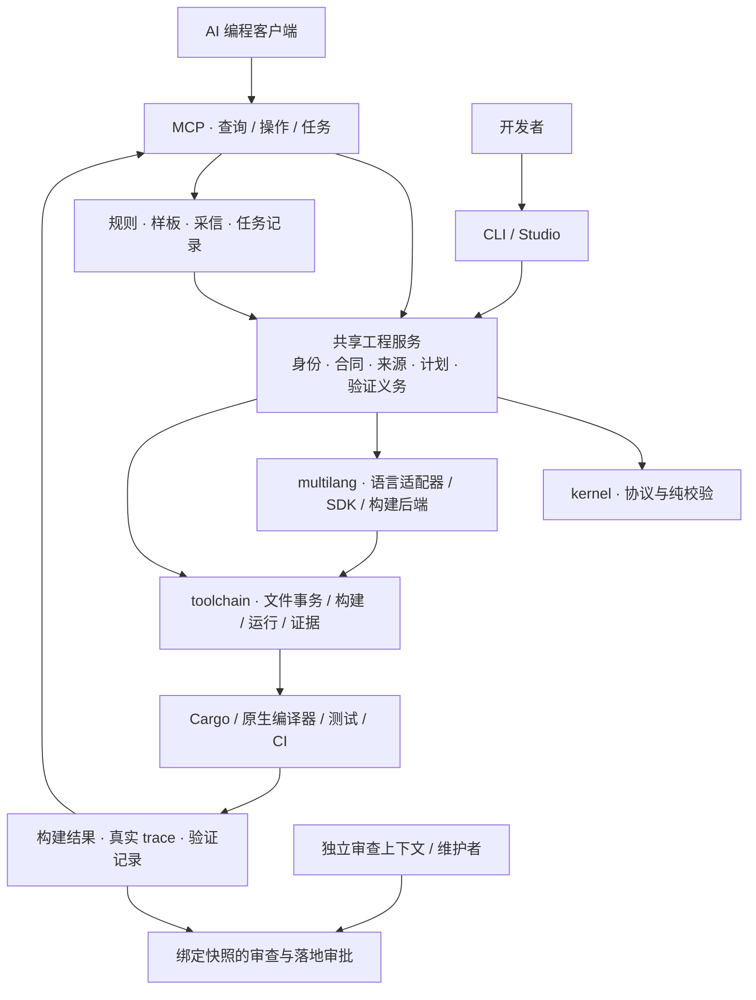

<div align="center">


# XiRang · 息壤

**把 AI 的代码修改变成有边界、可组合、可验证的工程操作。**

显式注册合同 · 原子化维护操作 · 混合语言构建 · MCP

[English](README.md) · [使用指南](docs/using-xirang.md) · [六类问题与实现](docs/ai-engineering-workflow.md) · [扩展语言](docs/extending-languages.md)

[](.github/workflows/ci.yml)
[](https://crates.io/crates/xirang-toolchain)
[](LICENSE)

</div>

息壤是一套面向 **AI 参与长期维护的混合语言项目**的工程框架。用注册声明把对象、父级、合同和源码归属写清楚，再通过同一套事实完成创建、迁移、嫁接、分区、验证和知识续接。CLI、Studio 和 MCP 是这套框架的不同入口。

开发者决定“什么可以改变、什么必须保持”；AI 在这个结构里提出和执行改动，编译器、测试与审查分别提供证据。它适合组件平台、框架和多团队维护的工程；不要求把每个辅助函数都注册成对象。

> **息壤**是中国神话里能不断生长的土壤。这里的含义是：新功能能从既有结构中生长，别人的实现能接入已有合同，而维护经验能留给下一次任务。

## 为什么需要它：六类 AI 工程问题

| 问题 | 息壤提供的机制 | 得到什么；保证到哪里 |
| --- | --- | --- |
| **缺少真正的项目记忆** | 对象身份、规则簿、已采信样板、模板继承记录、可恢复任务 | 记住依据、版本和适用对象；源码变化会让相关采信失效。不是聊天摘要，也不自动把 AI 建议升级成规范。 |
| **局部正确，全局失控** | `affected` / `impact` / `converge` 联合源码关系、注册关系、合同与验证计划 | 追踪提供者、消费者和测试；未解析调用与范围外消费者仍是待核验项。 |
| **认不出项目里的“承重墙”** | 父级规则、准入、能力依赖、类型合同、发布作用域 | 把必须保持的结构写成显式约束，减少只看引用次数的猜测；未声明的业务不变量仍需团队补充。 |
| **顺手重构，变更范围失控** | 操作预览、候选副本、scope / protect、扩围审批、事务落地 | 候选落地检查越界与过期基线；普通 MCP 不阻止其他 shell 写入，进程写域需显式托管执行。 |
| **把编译通过当成功能正常** | 区分 build / test / 运行证据，持久验证义务，任务关闭检查 | 编译成功不抵充行为测试。验证只覆盖实际执行的用例，不证明未测行为。 |
| **自己开发、自己审查，同源盲区** | 原始需求、验收条件、实际改动和验证证据组成审查包；判定绑定包摘要 | 可要求独立审查后才落地；MCP 工具不能给自己写 review pass。真正独立的审查上下文由宿主或团队提供。 |

这些机制已有实现，但组合起来不等于自动解决所有工程错误。逐项入口、反例与边界见[六类问题的工程闭环](docs/ai-engineering-workflow.md)。

## 先跑起来

本页面向**当前源码检出**；发布包可能晚于这里介绍的能力。需要 Rust 1.96.0+；C++ 路径还需要本机 C++ 工具链。

```sh
git clone https://github.com/Nichtigott/xirang
cd xirang
XIRANG_CHECKOUT="$PWD"
cargo install --path toolchain --features cli,lang-cpp

xirang new my-app --lib --path "$XIRANG_CHECKOUT"
cd my-app

# 先看计划，再创建一个能容纳子对象的 Panel。
xirang face add panel --lang rust --fields '{"needs_registry":true}'
xirang face add panel --lang rust --fields '{"needs_registry":true}' --write
xirang face show src/panel/panel.rs
xirang check
cargo build
xirang explain root/panel --json
xirang studio
```

`--path` 指向息壤检出，不是新项目的目的地。纯 Rust 用户可安装 `--features cli`。cli 同时启用 xirang、cargo-xirang、xirang-mcp、xirang-studio 四个入口；语言 feature 不会替你安装对应编译器。

**接已有项目：** 在普通依赖和构建依赖中加入同来源的 xirang-toolchain，在 build.rs 调用 `build_method::run()`，在拥有注册树的 crate 根调用 `run_method::host!()`。保留已有构建工作，避免重复挂载同一模块。[完整接入步骤](docs/using-xirang.md#2-接入已有-rust-项目--add-an-existing-rust-project)。

## 从“改文件”到可组合的操作


这里的**原子化**指把维护意图拆成明确、可预览和可组合的操作。涉及多个文件的支持路径使用事务恢复；不表示任意操作序列都是一个数据库事务，也不承诺断电后的全局原子性。

| 意图 | 操作 | 关键语义 |
| --- | --- | --- |
| 增加或调整对象 | face add/edit；MCP apply: add/edit/rename | 先解析父级、语言和落点，再产生修改；编辑只改点名字段。 |
| 给对象加一层内部结构 | MCP apply: deepen | 扩展内部 parts，保留对外注册位置。 |
| 移动对象或子树 | MCP apply: move | 同步支持范围内的引用、台账和迁移记录；稳定对象与源码实例身份分开处理。 |
| 换一个实现 | graft；MCP apply: cut | 声明切口，校验替换合同，计算有效树。 |
| 将确认后的替换落入基树 | MCP apply: promote | 显式确认后更新目标声明、退役切口与记录；有来源和可重写条件。 |
| 调整编译归属 | xirang crates | 把子树交给生成 crate，连接依赖与 facade；权威源码仍在宿主。 |
| 删除工具生成的面 | MCP apply: delete | 进入可恢复的 trash；手写面改写需要另行接管。 |

注册关系、文件位置、编译归属是三个维度。`StableFaceId` 记录对象连续性；`NodeId` 标识源码实例，移动或改名可能产生新实例，工具记录映射。不能把“对象仍是同一个”误写成“所有 ID 都不变”。

从上面的 my-app 开始，在宿主根目录执行：

```sh
# 先预览 src/ 外的子对象。
xirang-mcp --call apply --json '{"action":"add","language":"rust","parent":"root/panel","file":"components/reading/reading.rs","fields":{"module":"reading","kind":"Reading"}}'
# 执行同一请求。
xirang-mcp --call apply --json '{"action":"add","language":"rust","parent":"root/panel","file":"components/reading/reading.rs","fields":{"module":"reading","kind":"Reading"},"apply":true}'

# 预览提升到根级；确认后给同一请求加 "apply":true。
xirang-mcp --call apply --json '{"action":"move","node":"root/panel/reading","to":"root","rebind_grafts":true}'
```

预览成功之后仍需构建和行为验证。[使用指南](docs/using-xirang.md)补全编辑、rename、move、分区和恢复路径。注意 CLI `xirang move` 移的是**生产单元目录**，不是上述注册对象操作。

## Graft：让替代实现成为工程中的正式选项


例如，团队想把默认按钮换成另一个团队维护的高速实现。graft 声明“**这个槽位由那个兼容实现承担**”，不要求把外部代码复制进基树，也不要求为了选择实现长期维护整仓分叉。

宿主入口中的类型化计划可以写成下面这样（外部实现需先作为依赖链接）：

```rust
pub const GRAFTS: &[Graft] = &[
    graft(crate::catalog::control::button::NODE_ID)
        .with(control_button_graft::button_fast::NODE_ID),
];
```

graft(...) 选择槽位，.with(...) 选择实现。覆盖层校验框架、目标、准入和适用合同后返回新的有效树；槽位身份与实现身份分开保存。默认替换与整子树替换的规则见 [graft 参考](docs/graft.zh-CN.md)。

**和 Git 分支的关系：** Git 保存源码版本和变更历史；graft 在一个明确的宿主合同下表达实现选择。可以在同一源码版本上构造基树和替换树，分别验证；实现的开发、评审和发布依然使用 Git。

**和自动分派的关系：** 当前 graft 不会自动截获普通 `Button::paint()` 调用。已有示例通过宿主受控入口读取绑定并调用外部实现，再记录执行 trace；通用自动分派尚未实现。注册一个对象也不会自动获得跨语言 ABI。

```sh
# 在息壤检出根目录
cargo test -p xirang-example-control-button --test registry
cargo test -p xirang-example-control-button --test graft_behavior
tools/xirang-graft-binding
xirang explain --overlay --path examples/control-button --json
```

这几步分别检查注册树、受控行为切换、MCP 对真实 trace 的读取和静态投影。binding 是声明，observed 是某次运行的观察，两者分开展示；它们不证明任意方法都会自动路由。

## 混合语言：同一工程事实，各自的语言工具链

Rust 和 C++ 对同一个注册对象使用同一逻辑目录：

```text
crate::catalog::shop::panel::Area::NODE_ID
```

Rust 的 crate 是语言关键字；C++ 的 crate 是生成头提供的命名空间。路径来自**父级身份与注册名**，而非各语言的源码目录。下面是真实 [mixed-shop](examples/mixed-shop) 的关系：


面留在作者的源码位置；分区规划决定谁编译它。`tools/xirang-mixed-shop` 检查真实混合树、分区和调用结果，并包含故意改坏 C++ 实现的反面控制。

语言支持按层阅读，不能用“支持某语言”代替全部能力：

| 层 | 当前入口与范围 |
| --- | --- |
| **声明与创作** | Rust；可选适配器 C++、Python、C、Zig、JS、TS、Go、Java、C#。用 xirang face languages 查看当前二进制实际启用的字段。 |
| **进入宿主注册树** | Rust 生成树、原生对象记录、[record] 文件生产者。各语言 SDK 和宿主在 [examples](examples)；组合能力按相应门禁验收。 |
| **生产构建与交付** | xirang.toml 的后端和动作计划，查询 xirang languages。构建后端与注册适配器是两种能力。 |
| **调用语义** | Rust syn、C++ clang、Python AST 接入共同事实；其他语言的创作支持不意味着已有调用图后端。 |

也可以先用独立 C++ 生产项目体验“计划 → 构建 → 测试 → 证据”：

```sh
xirang new math-kit --lang cpp --lib
cd math-kit
xirang plan --json
xirang build
xirang test
xirang report
```

[生产工作流](docs/using-xirang.md#production)进一步介绍依赖、锁定、打包、安装与回滚。跨语言调用只支持相应 ABI 和类型集合；统一注册不抹平语言的类型、所有权和线程模型。

## MCP 如何接入整个工程



MCP 把工程服务交给 Agent；它不承担编译器、业务测试和人的决策。CLI、Studio 与 MCP 共用相关事实和服务，但各入口支持的操作范围不同，例如 MCP 的多语言生产入口只读清单、计划与报告。

通用 stdio 客户端的配置示例（替换路径；外层格式依客户端而定）：

```json
{
  "mcpServers": {
    "xirang": {
      "command": "/absolute/path/to/xirang-mcp",
      "env": {"XIRANG_PACKAGE_ROOT": "/absolute/path/to/my-app"}
    }
  }
}
```

Agent 从 xirang.explore 取当前源码与责任上下文，用 xirang.apply 预览/执行结构操作，通过 xirang_tools 按需发现其他工具：

```json
{"tool":"candidate"}
```

只给 tool 读取 schema；执行时再加 arguments。推荐维护顺序为：**读责任与规则 → 确定允许范围 → 操作预览 → 候选实施 → 验证行为 → 独立审查 → 授权落地 → 记录知识与任务结论**。[完整 MCP 示例](docs/using-xirang.md#mcp)与[六类问题的执行路径](docs/ai-engineering-workflow.md)给出具体请求。

Studio 通过 `xirang studio` 进入：a/e/d 创作面、g 编辑 graft 记录、/ 搜索、b 构建检查；以当前页提示为准。[真实界面截图](picture/xirang-studio-current.webp)及其[采集说明](picture/README.md)。

## 和 CodeGraph 相比，优势在哪里？

CodeGraph 已有语法树、符号解析和调用关系能力。息壤的差异是：**在代码理解之外，把明确的工程意图连接到可执行维护操作。**

| 需求 | 息壤增加的工程事实和操作 |
| --- | --- |
| 找到一个方法和它的调用者 | 查询源码关系，同时可返回注册归属、合同、graft 声明和已有运行证据。 |
| 判断一个改法是否允许 | 根据已声明的父级规则、能力要求、准入与适用维护规则检查，而不只推测代码关系。 |
| 换实现、搬对象、拆包 | 用 graft / move / crates 表达不同意图，维护各自的身份、引用和构建事实。 |
| 把经验交给下一位 Agent | 保存带依据与失效条件的采信、规则、样板和任务；后续任务重算是否仍成立。 |
| 控制 AI 的交付 | 候选范围、受保护内容、验证计划、审查包和落地批准形成可检查的流程。 |

**已有对照不支持“全面胜出”。** [2026-11-01 对照报告](docs/two-arm-results-2026-11-01.md)中，15 题的证据项覆盖为 43/43 对 37/43，但息壤回复更长；6 会话 pilot 两臂均机械成功，息壤成本当量合计为 CodeGraph 的 **1.19 倍**。对照为 CodeGraph 1.6.1，工具版本和装置口径见报告；正式 18 会话新版实验未运行成功。证据项覆盖不是调用图准确率，也不是模型修复成功率。

选择息壤的理由是需要**注册合同、结构操作、混合构建和维护证据之间的连接**。仅需阅读任意现有仓库时，代码索引工具已经很有价值。

## 如何增加一门语言

```sh
# 在息壤检出中预览适配器骨架；不会写入。
xirang lang new mylang --extension ml --checkout .
# 写入骨架及 feature / registry 接线；还需实现该语言。
xirang lang new mylang --extension ml --checkout . --apply --register
```

扩展住在 `multilang/src/languages/<language>/`，SDK 在 `multilang/sdk/<language>/`。复用 languages/kit 的语法字段、计划和记录组件，实现 LanguageAdapter，按需增加记录生产者、语义提供者或生产后端；既有协议内的新语言无需往纯内核添加语言特判。

脚手架不是语言实现。需要真实源码往返、宿主构建、运行树与失败用例；缺工具链记未验证，不能算支持。参见[语言扩展指南](docs/extending-languages.md)。

## 接入要付出什么

你需要选择有工程意义的注册边界，声明父级与合同，接入宿主构建，并提供行为测试。普通业务函数仍按原语言编写。受工具管理的声明、手写源码、生成 crate 各有写入规则；生成 crate 不能作为另一份权威源码独立维护。

息壤自身也按这个方式演进：纯规则放在 [kernel](kernel)，I/O 与进程绑定放在 [toolchain](toolchain)，语言实现放在 [multilang](multilang)。具体缺陷形成回归测试，可机械判断的约定进入 [conventions](conventions)；维护决定与历史评测保留在 [docs](docs)。规范的固化依赖明确决策和反面测试，不能靠模型反复自我确认。

## 验证与参与

```sh
cargo fmt --all -- --check
cargo test -p xirang-conventions --offline
cargo test --workspace --offline
cargo clippy --workspace --all-targets --offline -- -D warnings
cargo clippy --workspace --all-targets --offline --all-features -- -D warnings
tools/xirang-publish --check-table
tools/xirang-test
```

--offline 适合已有依赖缓存的开发环境；冷环境首次运行需获取依赖。xirang-test 从清单发现测试特性面，并检查没有任何面覆盖的“灰测试”。真实操作演练另见 [island-loop](tools/xirang-island-loop)、[mixed-shop](tools/xirang-mixed-shop)、[partition-rehearsal](tools/xirang-partition-rehearsal)、[API compat](tools/xirang-api-compat)。脚本存在不代表当前工作树已通过；验收必须对应实际执行和快照。

欢迎贡献真实需求、最小反例、语言适配器和兼容实现。请同时说明成功路径、失败路径与验证边界。[仓库规则](AGENTS.md) · [Issues](https://github.com/Nichtigott/xirang/issues) · [Discussions](https://github.com/Nichtigott/xirang/discussions) · [MIT](LICENSE)
