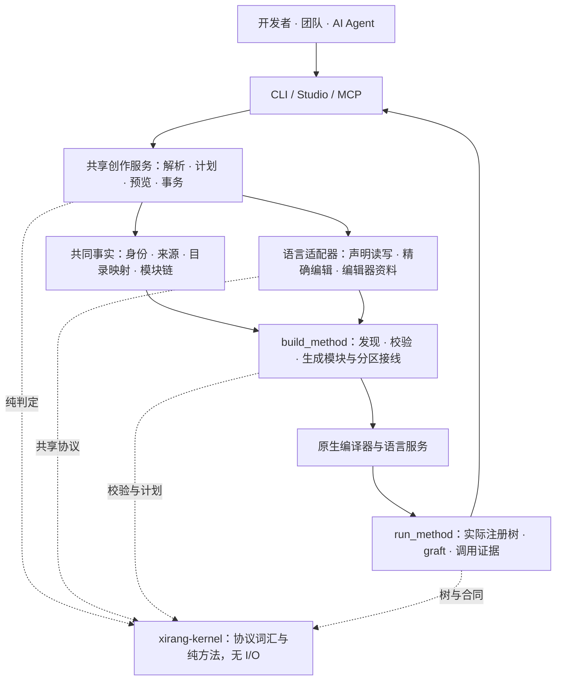

<div align="center">


# XiRang · 息壤

**让代码自带组织关系与协作边界，供人和 AI 一起扩展、替换与验证的工程框架。**

[English](README.md) · [上手与日常使用](docs/using-xirang.md) · [扩展语言](docs/extending-languages.md) · [设计讨论](https://github.com/Nichtigott/xirang/discussions)

[](.github/workflows/ci.yml)
[](LICENSE)


</div>

一个 `Area` 可以挂在 `Panel` 下，源码放在独立目录，由另一个 crate 编译；团队也可以交付一个满足合同的新实现，在宿主选择的位置进行 **graft（嫁接）**。这些变化分别有自己的含义，工具负责维护它们之间的连接。

息壤以 Rust 宿主为基础，提供注册协议、构建接线、CLI、Studio TUI 和 MCP。适合需要长期维护的框架、组件库，以及多人、多 Agent 共同演进的工程。小型、一次性程序通常直接使用普通模块就足够。

> **名字的含义**：息壤是中国神话中能够不断生长的土壤。这里借它表达一种工程愿望：新增部分沿着已有结构生长，也能接入来自其他人的实现。`Soil` 是注册声明，`graft` 是嫁接，`Registry` 是承接这些对象的注册树。

这个项目从两个问题汇合而来：**能否让 AI 在动手前就读懂工程责任，而不是每次靠提示词重讲？能否让代码结构本身就为社区的独立实现留下接入点？** 前者需要可检查的上下文与变更边界，后者需要明确的合同与替换机制。息壤把两者放进同一个组织模型。

直接收益是：新增对象不必逐一维护父级子对象清单，替换实现有明确的校验入口，人、编辑器与 Agent 可以围绕共同事实交流。收益伴随声明和验证的维护成本，后文也会说明这些取舍。

## 五分钟开始

当前检出的完整能力建议从源码体验；已发布包与本分支可能处于不同阶段。需要 Rust **1.96.0 或更新版本**、Cargo 和本机链接器；C++ 示例另需 C++ 工具链。

```sh
git clone https://github.com/Nichtigott/xirang
cd xirang
cargo install --path toolchain --features cli,lang-cpp

# --path 指向息壤检出，使新宿主使用这份实现。
xirang new my-app --lib --path "$PWD"
cd my-app

# 创建之前先看计划；--write 才落盘。
xirang face add panel --lang rust --fields '{"needs_registry":true}'
xirang face add panel --lang rust --fields '{"needs_registry":true}' --write
xirang check
cargo build
xirang explain root/panel --json
xirang studio
```

发布版安装：`cargo install xirang-toolchain --features cli`。`cli` 会安装 `xirang`、`cargo-xirang`、`xirang-studio` 和 `xirang-mcp`；检出专用的 `xirang-dev` 不在其中。多语言创作能力以 `xirang face languages` 为准。

这里生成的是注册骨架，业务实现和行为测试仍由你补充。`check` 验证注册事实，`cargo build` 验证实际编译；两者都不能代替业务测试。

[完整使用指南](docs/using-xirang.md)包括接入已有项目、独立目录、编辑、MCP 配置、graft、分区、验证与团队协作。

## 三种变化，三种操作

| 你想做什么 | 机制 | 要保持或重新验证什么 |
| --- | --- | --- |
| 调整对象的位置、父子关系或源码落点 | `move` 与显式目录映射 | 对象连续性、父级、引用、台账和消费者 |
| 保留槽位，选择另一个实现 | `graft` | 边界合同、准入规则、有效树和行为 |
| 调整由哪些包编译 | `crates` 分区 | 逻辑目录、依赖边、类型归属和宿主接线 |

**注册树、文件树、编译分区可以对应，但不必一一绑定。** 默认创建遵循规则目录；用 `--file` 指定独立目录后，后代可继承新落点，也可再覆盖。文件夹仍然便于收纳多种语言，注册关系由声明与共同事实维护。

身份也有明确边界：当前 `NodeId` 保留源码实例身份的兼容规则；持久对象由 `StableFaceId` 和对象台账连接当前、历史实例。换绝对工作目录不应改变身份，修改源码身份拼写则可能产生新 `NodeId`，需要显式迁移。内容摘要标识所用版本，机器路径只负责定位。

本地来源声明与机器绑定已存在；**任意远程孤岛的固定快照物化、跨平台一致性和全量测试，不属于本轮基础验收的承诺**。生产管线已有 worker/queue 等入口，它们的存在不等于上述整体工作流已验收。

## 写普通代码，声明协作边界

业务类型和算法仍是普通 Rust。一个注册面说明“我是谁、挂在哪里、提供什么”，父对象无需手工维护每个子对象的清单。

```rust
pub struct Button;

#[xirang_toolchain::soil]
pub const SOIL: xirang_toolchain::Soil = xirang_toolchain::Soil::of::<Button>()
    .under(crate::control::NODE_ID)
    .exports(&["control.render"])
    .needs_registry(false);
```

这是已有 `Control` 父面的声明片段；完整可编译示例在 [control-button](examples/control-button)。`exports` 是声明信息，真实实现和类型合同仍要写出来。

| 词汇 | 回答的问题 |
| --- | --- |
| `Soil` / 注册面 | 这个实现如何进入共同的工程结构？ |
| `Registry` | 对象挂在哪里，谁拥有下一层？ |
| `registry_rule` | 进入这一层至少需要哪些结构、接口与导出？ |
| `admission` | 这一分支允许使用哪些外部注册路径？ |
| `FlowContract` | 替换边界承诺怎样的合同标识、版本、输入与输出？ |
| `catalog` | 如何引用对象，而不把它当前由哪个 crate 编译写死？ |
| `graft` | 在指定槽位选择哪个兼容实现？ |

类型约束交给 rustc；结构规则、准入与嫁接校验由息壤补充。合同标签相同不能证明算法语义相同，仍需消费者测试与反例。

## 代码结构如何带有社区性

贡献者可以维护独立实现，宿主选择接入位置，原始框架和第三方源码各自保留。实现之间因此可以形成“同一合同下的候选”，便于比较、试验与替换。

```rust
pub const GRAFTS: &[xirang_toolchain::Graft] = &[
    xirang_toolchain::graft(crate::catalog::control::object::BUTTON)
        .with(control_button_graft::button_fast::NODE_ID),
];
```

这段来自仓内示例的组织方式。嫁接前校验边界，宿主在代码中明确选择；它不自动让所有 Rust 调用改道，也不自动获得热更新。调用与有效注册树的连接必须由宿主完成。

第三方作者不必为了交付一个替换件维护整个框架 fork；宿主维护者也不用接收每一种实现。**社区性来自可发布的边界和可选择的接入点**，其质量依赖清晰的合同、版本政策和验证，而非只靠目录命名。

阅读：[嫁接与协调替换](docs/graft.zh-CN.md) · [声明与语言扩展](docs/extending-languages.md)。

## 项目本身就是记忆

息壤尝试把工程思维嵌入 AI 工作流：让模型读到当前对象的责任、可用先例、改动边界和验证义务。聊天可以结束，项目保留的声明、规则、采信记录与测试继续存在。

| 新成员或新 Agent 会问 | 项目应该提供的记忆 |
| --- | --- |
| 这个功能放在哪里？ | 对象职责、注册归属、源码位置与依赖关系 |
| 同类功能通常怎么写？ | 适用的兄弟对象、已采信标本、允许不同的变体 |
| 哪些接口和边界不能随手改？ | 类型与数据合同、能力提供者、消费者和准入规则 |
| 命名、别名和注释为什么这样写？ | 约定的来源、适用范围、检查器及例外理由 |

记忆需要新鲜度。源码改变后，旧采信可能失效；同级对象写得相似，也不能证明它们正确。有效经验应有适用条件、正常用法、能抓住错误的反例，以及不应被拒绝的合法变体。

### 横向扩展与纵向演进

新增同族对象时，先找适用标本和父规则，复用边界，再实现差异，并验证旧兄弟的行为仍成立。新增一层职责时，先明确对外承诺，再组织内部对象，并验证消费者真的经过新层。

MCP 将这条过程接到工具：`explore` 获取源码与责任上下文，`consistency` 比较同族，`converge` 连接合同、消费者与证据，`apply` 提供结构变更预览，`check` 与候选工作流承接验证。

```text
理解目标 → 找适用先例 → 明确范围与预算 → 预览改动
        → 执行 → 编译与行为验证 → 独立审查 → 接受可复用经验
```

这是推荐的工程工作流。具体强制程度取决于启用的执行模式与项目政策：普通 MCP 无法拦住外部 shell 写入；候选落地检查也不等于操作系统沙箱。发现上游根因时应提出扩大范围的证据，不能靠下游补丁绕过合同，也不能擅自扩大权限。

### 标准如何逐渐固化

本项目采用“真实问题 → 最小反例 → 修复 → 回归 → 约定”的演进方式。可机械验证的标准进入 [conventions](conventions)，例如内核不得做 I/O、模块挂载规则、公开路径兼容、文档示例和特性门控。业务语义不能机械判定的部分保留明确的测试和审查义务。

标准本身也需要测试：坏实现要被拒绝，好实现和合法例外应能通过；历史记录不能冒充当前证据。新经验先成为候选，经项目政策接受后再复用，不能把一次模型建议直接升级成永久规定。

[使用指南的 MCP 章节](docs/using-xirang.md#mcp)介绍当前入口。项目记忆和托管维护是持续演进的方向；具体保证应以执行模式、代码和对应验收为准。

## 一个模型，多个入口



| 部分 | 职责 |
| --- | --- |
| [`kernel/`](kernel) | 身份、注册、树、合同、语法、纯判定；不读文件、不绑定进程 |
| [`toolchain/`](toolchain) | 构建、运行、证据、插件、Studio、MCP、CLI 七个执行面及共享创作服务 |
| [`multilang/`](multilang) | 语言适配器、SDK，以及独立的多语言生产管线 |
| [`macro/`](macro) | Rust 声明的编译期前端 |
| [`conventions/`](conventions) | 针对本仓库的可执行工程约定，不作为运行依赖发布 |

语言差异留在适配器，文件与进程操作留在执行面。CLI、MCP 和 Studio 复用服务；新增语言不应再为三个界面分别实现一次身份、目录和事务逻辑。

### 如何扩展一门语言

**注册适配器**负责声明；**构建后端**负责实际构建与测试。根据目标分别实现，不能用其中一项代替另一项。

| 层 | 扩展者需要提供 |
| --- | --- |
| 注册与编辑 | `LanguageAdapter` 的能力表、`plan`、`read`，需要时提供 `plan_move` 和 `editor_material` |
| 编译与运行 | 来源发现、动作计划、真实构建/测试、诊断与证据；可用独立后端进程接入 |
| 跨语言调用 | 可表达的 ABI、生成绑定、所有权与错误约定、消费者验证 |
| 完成判据 | 真实宿主、读写往返、混合父子关系、失败无副作用、跨工作目录身份与消费者一致性 |

Rust 与 C++ 已有混合注册的真实宿主演练。Python 有声明适配器和 SDK，**其接入这套基础架构的生产链仍暂停**；这不抹去独立生产管线中已有的 Python 能力。其他语言按后端逐项声明，不能从语言出现在列表中推导“全功能支持”。

普通 rust-analyzer/clangd 消费原生声明与生成资料。跨语言补全需要对应的类型与绑定资料；路径映射无法让任意语言类型无损互通。详见[语言扩展指南](docs/extending-languages.md)。

## CLI、Studio 与 AI 协作


*当前程序在临时宿主上的真实终端画面；截取树、详情与操作区，省略旧装饰横幅。*

CLI 适合脚本，Studio 适合浏览与交互创作，MCP 适合 Agent 按证据操作。Studio 中用 `a` 添加、`e` 编辑、`g` 管理 graft、`/` 搜索、`r` 重载、`b` 构建检查、`q` 退出。

MCP 服务启动：

```sh
XIRANG_PACKAGE_ROOT=/absolute/path/to/my-app xirang mcp
```

从 `xirang.explore {"query":"root/panel"}` 开始；默认入口还有 `xirang.apply` 与 `xirang_tools`。工具回复区分声明、静态候选、构建投影和已记录的运行证据，不能把“找到关联”直接当作“已经证明根因”。[配置与调用示例](docs/using-xirang.md#mcp)。

团队协作时，共享源码、合同、对象台账和被接受的规则，机器路径留在本机绑定中。每个任务使用独立分支或工作副本、明确写范围，验证绑定到具体快照。多 Agent 并行适合分离的修改与独立审查；同时编辑同一批文件会使证据失效，息壤不替代 Git 合并与冲突处理。

## 从哪些工具学习

| 工具或方法 | 主要切入点 | 息壤的关系 |
| --- | --- | --- |
| Rust 模块、trait、Cargo | 语言类型、模块与包依赖 | 保留这些机制，在其上表达对象归属、边界和替换意图 |
| CodeGraph / CodeQL | 符号、调用关系、代码分析 | 可协作；息壤侧重声明的责任关系及受控变更，静态分析仍有价值 |
| Bazel | 构建图、平台、缓存、执行与测试规则 | 借鉴输入闭包和证据意识；不宣称现有分布式能力或生态与其等价 |
| 插件 / DI / 分布式注册 | 发现实现、选择依赖、装配应用 | 增加递归注册树、合同与 graft；是否需要取决于项目复杂度 |

目标是减少“理解工程、保持连接、证明改动”的重复劳动。是否更省时间、token 或算力，要在相同任务、配置和验收标准下测量；没有通用领先结论。探索重点是责任上下文、输入闭包和交付证据；尚未据此建立通用性能排名。

## 接受哪些变化

引入息壤意味着维护注册声明、合同和验证；采用宿主构建接线，并让受管理的结构修改经过工具。默认目录约定降低配置成本，独立目录映射提供弹性，但不能把任意手工搬文件视为完成迁移。

生成 crate 是编译产物的组织方式，不天然是另一份可独立编辑的源码仓库。应在权威宿主源码修改，再重生成；多个可写孤岛的版本同步、固定快照测试与远程调度，还需要各自的明确协议和验收。

增量索引、全链路并行和性能优化仍有后续工作；部分原生声明包目前绕过行缓存。注册树也不等于完整调用图：动态分派、FFI 和运行期数据需要实际观测，未观测不能解释成不存在。

## 息壤如何使用息壤

本仓的 [control-button](examples/control-button) 与 [第三方 graft](examples/control-button-graft) 是真实宿主，演示声明、合同、替换和运行期树。结构操作通过 [island-loop](tools/xirang-island-loop) 和 [partition-rehearsal](tools/xirang-partition-rehearsal) 驱动真实 MCP/Cargo，API 兼容用[仓外调用方](tools/xirang-api-compat)验证。

仓库的维护约定写在 `AGENTS.md`，可执行部分进入 conventions。这里的“自用”指真实宿主、工具链和维护流程的持续验证，不意味着每个普通工具函数都被注册成对象。

```sh
# 在息壤检出根目录；需要相应工具链。
tools/xirang-island-loop
tools/xirang-partition-rehearsal
tools/xirang-api-compat
tools/xirang-test
```

各脚本默认离线设置及冷环境用法见脚本说明。验收结果必须绑定源码快照；历史通过不自动代表当前检出通过。旧 API 兼容入口仍保留，扩展者应同时验证旧调用方与旧 trait 实现者。

## 继续阅读与参与

[使用指南](docs/using-xirang.md) · [语言扩展](docs/extending-languages.md) · [嫁接](docs/graft.zh-CN.md) · [迁移](docs/migration.zh-CN.md) · [威胁模型](docs/threat-model.zh-CN.md) · [路线图](docs/ROADMAP.zh-CN.md)

欢迎提交具体场景、最小反例、语言适配器和合同兼容的独立实现。提交功能时附上成功路径、失败路径与验证范围；提交新规范时也说明它允许哪些合法差异。

[MIT License](LICENSE) · [Issues](https://github.com/Nichtigott/xirang/issues) · [Discussions](https://github.com/Nichtigott/xirang/discussions)
