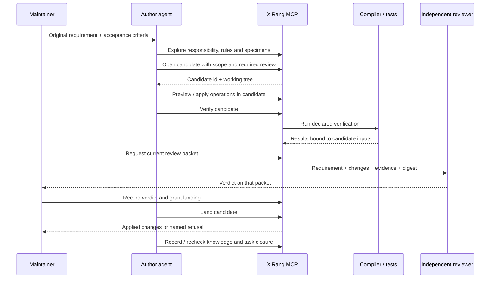

# AI 工程维护：六类问题如何进入工作流
# AI engineering maintenance: six problems, concrete mechanisms

[中文首页](../README.zh-CN.md) · [English](../README.md) · [使用指南 / User guide](using-xirang.md)

本页按当前实现解释机制与边界，不是“六类问题已彻底消除”的验收声明。注册提供工程意图的锚点；语言分析提供源码事实；测试和独立审查提供不同来源的证据。三者不能互相冒充。

This guide describes implemented mechanisms and their limits, not a claim that all six problems are eliminated. Registration anchors engineering intent; language analysis supplies source facts; tests and independent review supply different evidence.

## 1. 缺少真正的项目记忆 / No durable project memory

**要记的不是“上次 AI 说了什么”，而是“哪条决定，基于什么，在什么范围内仍然成立”。**

A useful memory records a decision, its basis, its scope and whether it still holds.

| 知识 / Knowledge | 当前载体 / Current carrier | 如何使用 / How it is used |
| --- | --- | --- |
| 对象、父级、来源、历史位置 / Objects, parents, sources, previous locations | 注册声明、catalog、对象台账 / Declarations, catalog, object ledger | 经共同身份解析对象；move 记录稳定对象与实例变化 / Resolve objects and track migrations |
| API、能力、不可违反的结构 / APIs, capabilities, structural constraints | 类型合同、requires/provides、父级规则 / Typed contracts, requirements, parent rules | 构建/注册检查与责任查询 / Build checks and responsibility queries |
| 已决定的维护规范 / Accepted maintenance policy | `.xirang/rules/` | 规则有作用域、来源、版本、状态与例外 / Scoped, versioned rules with provenance and exceptions |
| 谁采信过什么 / Adopted decisions | `.xirang/adopted/entries` | 基于文件指纹的临时采信，字节变化后失效 / Provisional adoption tied to file fingerprints |
| 复用哪份结构 / Template lineage | `.xirang/templates/lineage.tsv` 与已采信样板 / Adopted specimens | 追踪对象跟随的模板版本；变化后列出需迁移对象 / Track specimen versions and affected followers |
| 还欠哪些验证 / Verification obligations | check 的持久计划与日志 / Durable check plans and journals | 中断后恢复，重查输入与配置 / Resume and recheck inputs/configuration |
| 某次任务凭什么完成 / Task closure | `.xirang/tasks/` | 五项义务重新计算，closed 记录保留历史结论 / Recompute obligations while preserving closure history |

新增对象时，当前样板选择按**父级与 kind**寻找仍生效的已采信样板：唯一则引用；冲突则要求选择；没有则记录候选，不凭多数兄弟的形状宣称它是规范。当前自动模板承接主要处理 preset / parts 等支持字段，不能代替任意业务代码生成，也不是完整的注释和命名模板系统。

For a new object, specimen selection uses parent and kind and checks adoption standing. A unique specimen can be followed; conflicts require a choice; no specimen means a candidate, not an invented standard. Mechanical template carry is limited to supported fields such as preset/parts, not arbitrary business code or a complete naming/comment template system.

已有对象的批量演进通过 `refactor`：先重新核验并采信修改后的样板，再按 `.xirang/templates/lineage.tsv` 找到跟随对象，预览并显式应用支持的字段迁移。仅复制仍为默认值的 `preset` / `parts`；非默认值、删除字段、手写文件与测试入口差异需决策。谱系没有保存旧模板全文，不能区分旧版复制值与主动定制值，因此不会自动覆盖二者。保存模板不触发全项目写入；各跟随对象分别迁移并推进版本。见首页[模板演进图](../README.zh-CN.md#project-memory)。

Existing followers evolve through `refactor`: verify and reconfirm the changed specimen, enumerate its lineage, preview, then explicitly apply supported migrations. Only default `preset` / `parts` values are mechanically filled. Non-default values, dropped fields, handwritten files and test-entry differences require decisions. Lineage does not retain historical template bytes, so an old copied value cannot be distinguished from deliberate customization. Saving a template does not rewrite the project; followers migrate and advance individually. See the [template evolution diagram](../README.md#project-memory).

API 命名、注释规范、错误处理、测试策略、依赖政策、兼容性与废弃计划、部署约束、性能预算，都可以成为项目知识。**其中哪些能执行，取决于是否已接入具体检查器**；自然语言要求本身不会变成证明。息壤自己的命名/注释/目录约定由 conventions 执行，接入息壤的项目不会自动继承这些仓库特有政策。

Naming, documentation, errors, testing, dependency policy, compatibility, deployment and performance budgets are useful knowledge categories. Enforceability depends on actual checkers. XiRang's own conventions do not automatically become every host's policy.

**相关实现 / Sources:** [规则判定](../kernel/src/registry_core/maintenance/decision.rs)、[采信](../toolchain/src/mcp/adopted.rs)、[样板选择](../toolchain/src/mcp/apply_template.rs)、[模板迁移](../toolchain/src/mcp/refactor.rs)、[任务](../toolchain/src/mcp/task.rs)。

## 2. 局部正确，全局失控 / Locally correct, globally broken

一个函数改对，不代表所有消费者仍满足原合同。息壤从两个方向组织影响：

- **代码方向**：定义、调用、共同提供者、下游测试；由 explore / callgraph / affected 查询。
- **工程方向**：对象归属、父级约束、能力依赖、graft 切口、编译归属；由 converge / impact / usages / explain 查询。

A correct local change can still break consumers. Source relationships and declared engineering relationships provide complementary impact views.

```sh
# 在真实宿主根目录 / In the host root
xirang-mcp --call explore --query 'Button::paint'
xirang-mcp --call converge --node root/control/button
xirang-mcp --call impact --node root/control/button
xirang-mcp --call affected --json '{"files":["src/control/object/button/button.rs"]}'
```

路径必须换成目标项目的路径。未解析的动态调用、尚无语义后端的语言、范围外消费者，都不能凭“没有返回边”判定不受影响。应把未知转为验证义务；是否验证所有实际消费者，需要团队给出验收面，不能仅依赖图自动发现。

Substitute your project's paths. An absent edge is not proof of no impact when resolution, language coverage or scope is incomplete. Turn unknowns into verification obligations and supply explicit consumer acceptance tests.

**相关实现 / Sources:** [责任上下文](../toolchain/src/mcp/converge.rs)、[影响测试](../toolchain/src/mcp/affected.rs)、[候选义务守卫](../toolchain/src/mcp/candidate_guard.rs)。

## 3. 认不出“承重墙” / Missing load-bearing structure

“承重墙”是很多地方依赖、而改动时必须保住的合同或不变量，例如共享坐标转换、序列化协议、公共 trait、父级要求的能力。引用次数只能提示重要性，不能说明允许怎么改。

A load-bearing component protects a contract or invariant: shared coordinate rules, serialization formats, public traits or required capabilities. Fan-in alone cannot express permitted changes.

息壤允许把这类意图分层写出来：

| 层 / Layer | 能表达什么 / Meaning |
| --- | --- |
| 类型合同 / Typed contracts | 注册实现满足所声明的 trait / 类型关系 / Declared trait/type compatibility |
| 父级规则和准入 / Parent rules and admission | 哪种子对象可进入、哪些外部来源可使用 / Allowed children and external registrations |
| 能力依赖 / requires / provides | 谁提供、谁依赖一项能力 / Explicit providers and consumers |
| graft 合同 / Replacement contracts | 某实现能否替换某槽位 / Compatibility of a replacement at a slot |
| 维护规则与保护范围 / Rules and protected scope | 已接受要求、不能顺手改变的内容 / Accepted commitments and protected content |

这些事实让 Agent 可以问“这个对象必须保住什么”，而不只是“哪里被调用”。没有声明的业务不变量依然未知；注册关系不自动证明算法正确。

These facts let an agent ask what must remain true. Undeclared invariants remain unknown; registration does not prove algorithmic correctness.

**相关实现 / Sources:** [合同](../kernel/src/registry_core/declaration/contract.rs)、[graft](graft.zh-CN.md)、[规则进入操作计划的测试](../toolchain/src/mcp/apply_rules_tests.rs)。

## 4. 顺手重构导致范围失控 / Unrequested refactoring

先区分三个保证层级；它们不会因为“已经接了 MCP”而自动全部生效。

Three distinct levels must be selected explicitly:

| 模式 / Mode | 当前保证 / Guarantee | 边界 / Limit |
| --- | --- | --- |
| 普通 MCP / Plain MCP | 结构请求预览；支持操作的写入事务 / Operation previews and supported write transactions | 拦不住另一个 shell 直接改基树 / Does not constrain another shell |
| 候选工作流 / Candidate workflow | 副本内工作，落地前核对 scope、保护内容、基线、验证与批准 / Copy, scope, protected content, freshness and approval checks | verify 本身不是进程沙箱 / Verification alone is not a process sandbox |
| 托管执行 / Managed execution | Linux Landlock 支持环境下限制指定子进程及后代的写域 / OS-enforced write domain for a launched process tree | 不约束 wrapper 外进程，不认证调用者 / No control over separately launched processes or caller identity |

候选落地时，越界改动、改过的基线、覆盖不到当前字节的验证都必须重新处理。扩围需要宿主授权，不是修改 scope 字符串就能给自己加权限。

A candidate's out-of-scope changes, changed baseline or stale verification require resolution before landing. Widening requires host authorization.

**相关实现 / Sources:** [候选入口](../toolchain/src/mcp/candidate.rs)、[范围与授权](../toolchain/src/mcp/candidate_approval.rs)、[落地](../toolchain/src/mcp/candidate_landing.rs)、[托管执行](../toolchain/src/mcp/managed.rs)。

## 5. 编译通过不等于功能正常 / Compilation is not behavior

把证据拆开，才不会把一条绿色日志当成全部完成：

1. **注册检查**：身份、父级、声明与结构是否合法。
2. **构建**：选定配置下的类型、链接与生成接线是否成立。
3. **行为测试**：真实输入是否得到期望结果，消费者是否仍满足合同。
4. **运行观察**：特定执行路径发生过什么；没观察到不等于不可能发生。
5. **反面控制**：故意恢复缺陷或换错实现，验收是否真会失败。

Registration validation, compilation, behavioral tests, runtime observations and negative controls answer different questions.

check 可以保存多项验证计划；task 关闭时重新计算 applied、verified、rules、knowledge、acceptance 五项义务。这里 applied 的精确含义是“对象当前字节符合任务记录”，不是“证明所有改动都由息壤完成”；acceptance 只在任务政策要求时必需。

A task recomputes five obligations. Applied means the current object matches the recorded bytes, not that XiRang performed every edit. Acceptance is required only when task policy says so.

**不要只给一份 build 计划就声称验证了业务。** 任务的验证范围由提供的计划决定；测试设计、真实消费者和独立期望值仍是工程责任。环境核验也只覆盖计划实际绑定的输入与环境前缀。

A build-only plan cannot establish behavior. Plan selection, real consumer tests and independent expected values remain engineering responsibilities. Environment verification covers the inputs and prefixes actually bound by the plan.

**相关实现 / Sources:** [验证计划](../toolchain/src/mcp/check_plan.rs)、[任务证据](../toolchain/src/mcp/task_evidence.rs)、[graft 行为测试](../examples/control-button/tests/graft_behavior.rs)、[绑定门禁](../tools/xirang-graft-binding)。

## 6. 同源审查盲区 / Author–reviewer blind spots

当前实现把**审查的输入与结论绑定**，并分开作者工具和宿主审查入口：

- 候选开启时保存原始 requirement / acceptance，不仅保留作者的实现总结。
- review packet 包含范围、实际内容差异与验证证据，带内容摘要。
- require_review 开启后，当前包没有 pass 就不能落地；改了内容或证据，旧 pass 不再覆盖它。
- MCP candidate 没有可记录审查通过的 review 动作；结论经宿主的 `xirang-mcp --review` 入口提交。

Review inputs include the original request, acceptance criteria, scope, actual changes and verification. Required reviews bind a verdict to that packet. The MCP candidate tool cannot record the pass itself.

**宿主仍须安排真正独立的审查上下文。** 换一个 reviewer 名字、把作者总结再发回同一个模型，都不证明独立。若 Agent 仍能通过不受限 shell 调用宿主入口，单靠工具分离也不能证明角色隔离；团队需要在编排与权限中落实它。不同模型或人审可增加视角，但不保证发现所有错误。

The host must supply an independent context and enforce role separation. A different reviewer name is not proof. An unrestricted shell can undermine separation between tool and host entry points. Independent reviewers can still miss defects.

**相关实现 / Sources:** [审查包](../toolchain/src/mcp/candidate_review.rs)、[审查反例与落地测试](../toolchain/src/mcp/candidate_review_tests.rs)。

## 一个可执行的团队分工 / An actionable team workflow



这些阶段由宿主或团队编排；不是单次 MCP 调用已经自动安排好作者、审查者和 CI。作者可以调用标准工具，审核者从原始需求与实际差异出发，CI 对交付快照重跑检查，维护者决定是否接纳新规范。

The host/team orchestrates these stages; a single MCP request does not launch an entire independent engineering organization.

以下例子在已存在 Panel 的宿主根目录执行。open **会创建候选副本**；后续修改应指向返回的候选 tree，不是基树。

The following assumes a host with Panel. Open creates a candidate copy; subsequent edits target its returned tree.

```sh
xirang-mcp --list candidate --full
xirang-mcp --call candidate --json '{"action":"open","scope":["src/panel"],"require_review":true,"requirement":"只修改 Panel 的行为，保持现有公开合同","acceptance":["真实行为测试通过","不修改范围外文件"]}'
```

记下输出里的 id 和 tree。在候选树运行 explore/apply 或编辑，然后从基树入口用该 id 执行 candidate verify / status。宿主获取审查包的命令如下，替换实际 id：

Record the id and tree; edit the candidate, then use candidate verify/status from the base root. The host retrieves the review packet:

```sh
xirang-mcp --review --root /absolute/path/to/my-app --id CANDIDATE_ID
```

独立评审后由宿主对**实际 packet digest**记录 pass/fail，再通过确认入口授权 land。命令参数与授权版本以当前 status 输出为准；旧包不能靠复用结论通过。任务知识记录是后续显式步骤，不应把 candidate land 当成 task close。

The host records the verdict against the actual packet digest and grants landing with the current proposal version. Follow status output. Landing a candidate is not the same as closing a maintenance task.

## Graft 在这里增加了什么 / What graft adds

graft 把“试试另一个实现”变成显式替换关系，允许在同一宿主合同下验证基树与替换树，并把声明绑定交给影响分析与审查。外部团队保有实现源码；宿主保有自己的槽位与接纳规则。它可以减少为接入替代实现而复制代码的需求。

Graft makes a replacement relationship explicit. The host owns its slots and admission rules; the external team owns its implementation. Base and replacement configurations can be verified under the same host contract.

当前示例的实际调用仍经过手写的受控入口，通用自动分派未实现。检查当前代码时也需注意：`slot_bindings` 的声明投影可能只有展示拼写而没有已解析 implementation_id；该例通过已知替换拼写选择实现，trace 记录宿主到槽位方法的执行。不能将它升级表述为完整的跨语言、逐调用点的实现分派证明。

The current example retains a handwritten controlled entry. Its declaration projection may carry a display expression without a resolved implementation id; the example selects a known spelling, and its trace records the host-to-slot-method execution. This is not a general, cross-language, callsite-level dispatch proof.

## 接下来怎样验证项目效果 / Evaluating the outcome

在自己的项目上重复完整任务，比只看单元测试数量更有意义：选择真实跨模块改动，预先固定允许范围、保护文件、消费者行为和验收条件，再比较是否修对、是否越界、是否留下可复用知识。新会话重开任务，检查过期规则/样板/验证是否被识别。

Evaluate real cross-module tasks with independently fixed scope, protected files, consumer behavior and acceptance. Start another session and check whether stale rules, specimens and verification are recognized.

[当前 CodeGraph 对照报告](codegraph-comparison.md)区分查询覆盖、模型成功与成本。它没有证明六类问题在大型项目上全部解决，也没有证明息壤全面优于 CodeGraph。本页的价值主张是工程机制的组合；效果需要项目级任务来验证。
