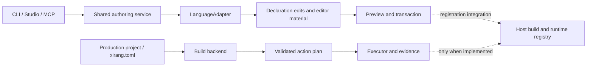

# 扩展一门语言 / Extending a language

[中文首页](../README.zh-CN.md) · [English overview](../README.md) · [User guide / 使用指南](using-xirang.md)

**先确定你要接入哪一层：声明、构建，还是跨语言调用。** 这三件事需要不同的实现与验收。多一个语言名或模板，不等于多了一门完整支持的语言。

**Choose the layer first: declarations, builds, or cross-language calls.** Each requires its own implementation and acceptance. A name or template is not complete language support.

## 两个扩展入口 / Two extension seams



| 入口 / Seam | 对应能力 / Responsibility | 当前位置 / Current source |
| --- | --- | --- |
| 注册适配器 / Registration adapter | 读写注册声明、精确修改、语言资料 / Declarations, precise edits, editor material | [`multilang/src/registration.rs`](../multilang/src/registration.rs) |
| 共享创作 / Shared authoring | 已解析父级、来源、落点、权限与事务 / Resolved parents, sources, placement, permissions, transactions | [`toolchain/src/authoring_service`](../toolchain/src/authoring_service) |
| 构建后端 / Build backend | 工程发现、动作计划、真实构建与测试 / Project discovery, plans, builds, tests | [`multilang/src/production`](../multilang/src/production) |
| 协议词汇 / Protocol | 语言标识、能力、跨语言类型和纯检查 / Language ids, capabilities, interchange types, pure checks | [`kernel/src/registry_core/interchange.rs`](../kernel/src/registry_core/interchange.rs) |

Rust 的创作适配保留在共享服务旁，因为它复用宿主生成器；C++ 和 Python 适配器位于 multilang。`multilang` 不依赖 toolchain，避免反向耦合。

Rust authoring remains beside the shared service because it reuses the host generator. C++ and Python adapters live in multilang, which does not depend on toolchain.

## A. 增加注册适配器 / Add a registration adapter

1. **声明真实能力。** 选择稳定语言 id、扩展名、可表达字段和结构操作。无法携带的合同字段必须拒绝，不得丢弃或近似。
2. **生成计划，不写文件。** `plan` 接收 `FaceAuthoringRequest`，返回 `FaceAuthoringPlan`：文件、精确修改、诊断和验证义务。执行面统一预览、检查与落盘。
3. **读回自己的输出。** `read` 返回 `FaceReadBack`，保留未修改字段、父引用、作者语法与业务代码。生成成功而编辑时丢字段不算完成。
4. **按能力接结构迁移。** `structural` 明确声明支持范围；`plan_move` 仅规划语言引用的精确修改，通用层持有身份、影响、权限和事务。
5. **提供原生编辑器资料。** 用 `editor_material` 返回 `PlannedFile`，必要时覆盖 `placement`。资料应来自相同解析事实，不能另猜一组依赖。
6. **登记与门控。** 在 `AdapterRegistry::builtin()` 登记实现，增加 `lang-<id>` 特性，并由 toolchain 同名转发；确认禁用特性时点名拒绝。
7. **接通真实注册。** 构建读取声明/记录进入同一面表，运行期树出现正确身份和父级。只有创作模板还达不到这一层。

In order: declare honest capabilities; plan without writing; read your own output; implement structural rewrites explicitly; generate native editor material; register and feature-gate the adapter; then prove that a real build and runtime tree consume it.

接口要点 / Interface responsibilities:

| 方法 / Method | 必须回答 / Contract |
| --- | --- |
| `capabilities()` | 这个二进制真正支持什么 / What this binary can carry |
| `plan(request)` | 如何把已解析请求变成可审阅的修改 / A reviewable edit plan |
| `read(source)` | 现有声明的完整规范字段与父引用 / Normalized fields and parent reference |
| `structural()` | 可规划哪些结构操作；默认无 / Explicit structural support; none by default |
| `plan_move(request)` | 按传入事实改语言引用；不另算身份 / Syntax edits from supplied facts |
| `placement()` | 语言允许的落点策略 / The language's placement policy |
| `editor_material(context)` | 原生语言服务需要哪些计划文件 / Planned native editor files |

`LanguageAdapter::read` 是现有 trait 契约，保持原名。部分语言模块的自由函数叫 `read_declaration`，不要据此改 trait。其他已改名的公开函数保留 deprecated 转发入口，新增语言也要验证旧调用方与旧实现者。

`LanguageAdapter::read` retains its public trait name. Some language-module free functions are called `read_declaration`; this does not rename the trait contract. Other renamed public functions retain deprecated forwarding entries; verify old callers and implementers when extending the API.

### C++ 作为实例 / C++ as an example

```cpp
#include <xirang/soil.hpp>
#include <xirang/faces.hpp>

struct Gauge {};

XIRANG_SOIL
constexpr auto SOIL = ::xirang::soil<Gauge>()
    .under(::xirang::faces::ROOT_NODE_ID)
    .named("Gauge")
    .needs_registry(false);
```

这是一段需要宿主生成头和 SDK include 路径的注册声明。`ROOT_NODE_ID` 由构建按宿主命名空间生成；C++ 不另造根身份。`XIRANG_SOIL` 将编译后的记录保留在对象文件中，构建读取它，而非要求普通用户手填身份字节。

This declaration requires the host-generated header and SDK include path. The build derives `ROOT_NODE_ID` from the host namespace. `XIRANG_SOIL` preserves the compiled record in the object file for extraction; users do not hand-author identity bytes.

参照 / Implementation references:

- [C++ adapter](../multilang/src/languages/cpp/adapter.rs)
- [C++ SDK](../multilang/sdk/cpp/xirang/soil.hpp)
- [Mixed host](../examples/mixed-shop)
- [Real island and mixed-parent rehearsal](../tools/xirang-island-loop)

CLI/MCP 的语言特性与宿主 build-dependencies 都要具备需要的 C++ 能力；本机还需编译器与记录提取工具。不要把安装了适配器等同于安装了编译器。

Enable C++ where needed in the authoring binary and host build dependencies. The machine also needs the compiler and record-extraction tools. An adapter feature does not install a compiler.

## B. 增加构建后端 / Add a build backend

生产管线可以委派独立后端进程。后端报告能力并返回计划，公共执行器校验动作与输入输出，再执行并记录证据。当前协议实现见 [delegate](../multilang/src/production/delegate.rs) 与 [record](../multilang/src/production/record.rs)；生成模板附有请求/应答实现。历史支持表不应替代当前握手结果。

The production pipeline can delegate to an external backend process. It reports capabilities and returns a plan; the common executor validates actions and inputs/outputs, runs them, and records evidence. See [delegation](../multilang/src/production/delegate.rs) and [records](../multilang/src/production/record.rs); the generated template includes request/response code. Historical support tables are not a substitute for a current handshake.

```sh
xirang languages
xirang backends new --language shell --backend team.shell --directory ./shell-backend
```

模板附带 README 并打印安装命令；按模板说明运行 `backends install`，然后在对应生产项目中执行：
The template includes a README and prints its installation command. Follow it to install the backend, then in a matching production project run:

```sh
xirang backends check --language shell .
xirang plan --json
xirang build
xirang test
```

`backends check` 核对握手和计划，不执行动作。`plan` 展示动作；真实编译和测试退出码必须由 `build` / `test` 验证。模板只是协议起点，不能拿模板语言的成功替另一门语言作证。

`backends check` checks handshake and plan conformance without executing actions. `plan` displays actions; actual compilation and test exit codes come from `build` and `test`. A working template proves the protocol path, not another language's semantics.

只有声明的后端记录可以展示能力和缺口；带可执行命令的记录才有委派入口。安装外部构建后端不会自动注册 `LanguageAdapter`、生成 Soil SDK 或获得安全 move 能力。

A declaration-only record can report capabilities and gaps; an executable command is needed for delegation. Installing a backend does not install a registration adapter, Soil SDK, or safe structural-move implementation.

## C. 跨语言调用与补全 / Interoperation and completion

明确类型映射、布局、所有权、生命周期、错误、字符串编码与线程规则。当前 C ABI 路径只能承载已实现的类型集合，不能把 Rust 泛型、C++ 模板或任意 Python 对象直接无损传过去。

Specify type mapping, layout, ownership, lifetimes, errors, encoding, and threading. Current C ABI paths support implemented type subsets, not arbitrary Rust generics, C++ templates, or Python objects.

生成头文件、绑定、类型声明与编辑器资料应消费同一版本的解析结果。补全成功后仍要编译调用方并断言真实返回值；测试还应把期望值改错，确认会失败。

Headers, bindings, declarations, and editor material should consume the same resolved version. Completion must be followed by a compiled consumer with assertions on real values. A deliberately wrong expectation should fail.

## 支持状态怎样阅读 / Reading support claims

| 能力维度 / Dimension | 查看方式 / Check |
| --- | --- |
| 能否创作注册面 / Author faces | `xirang face languages` 与适配器能力表 / adapter capabilities |
| 能否构建生产单元 / Build units | `xirang languages` 与后端握手 / backend handshake |
| 能否混合注册与迁移 / Mix registrations and move | 对应真实宿主门禁 / matching real-host gates |
| 能否导出、消费与补全 / Export, consume, complete | 对应 ABI 组合及语言服务测试 / ABI pair and language-service tests |
| 能否远程重现 / Reproduce remotely | 固定输入、工具链、平台与实际 worker 证据 / pinned inputs, tools, platforms, worker evidence |

Rust/C++ 混合注册已有真实宿主演练。Python 声明适配器与 SDK 存在，独立生产后端也已有部分能力；Python 继续接入这一轮基础架构的生产扩展仍暂停。远程协议和队列的实现不能替代多机、跨平台、固定快照的验收。

Rust/C++ mixed registration has real-host rehearsals. Python has an authoring adapter, SDK, and some separate production-backend capabilities; further production integration with this foundation is paused. A remote protocol and queue do not establish multi-machine, cross-platform, pinned-snapshot acceptance.

## 一门语言的验收清单 / Acceptance for an extension

- 创建 → 读回 → 修改 → 再读回；没点名的字段与业务字节保持。Create, read, edit, read again; preserve unspecified fields and business code.
- 默认目录、自定义库目标、独立目录、继承与嵌套覆盖。Default/custom targets, islands, inherited and nested placement.
- 新语言为父、为子、为根级面，并组合现有语言。Use the new language as parent, child, and root-level face with existing languages.
- move/graft/分区按声称支持的组合真实构建并检查运行树。Build and inspect actual trees for supported move/graft/partition combinations.
- 换绝对工作目录不改身份；同名源码不混淆；保持已发布身份兼容。Relocate checkouts, distinguish same-named sources, preserve published identity rules.
- 缺能力、工具链、来源或父级时准确拒绝；故障注入核验文件与台账。Refuse missing capabilities/tools/sources/parents; inspect files and ledger after injected failures.
- 原生编辑器与编译器消费一致资料，跨语言调用验证真实结果。Verify shared editor/build inputs and actual cross-language results.
- 禁用特性、单独启用和全特性都运行相关测试，不能以 `0 tests` 计通过。Run relevant tests with features disabled, isolated, and combined; zero tests are not acceptance.

只声明已经通过的组合，其他列为未实现或未验证。新增语言应增加适配器与证据，而不是把语言分支复制进每个界面。

Claim only exercised combinations. Mark the rest unimplemented or unverified. A new language should add an adapter and evidence, not duplicate language branches across the interfaces.
